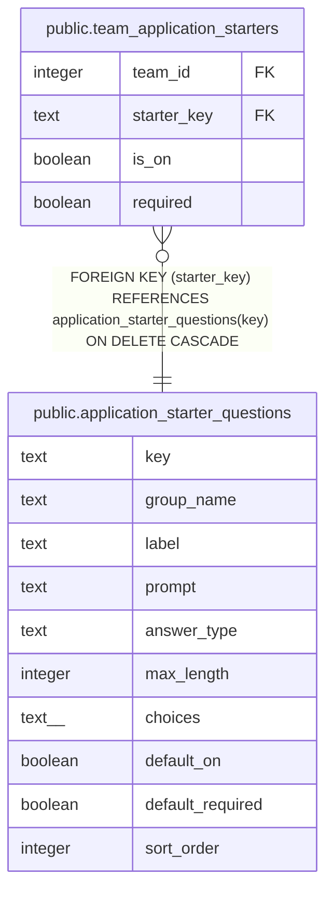

# public.application_starter_questions

## Description

The starter application questions (#1536), site-wide and the same for every guild, seeded by migration. A team switches each on or off and marks it required (team_application_starters); it never edits one. {team} and {raid nights} in prompt are filled by the page.

## Columns

| Name | Type | Default | Nullable | Children | Parents | Comment |
| ---- | ---- | ------- | -------- | -------- | ------- | ------- |
| key | text |  | false | [public.team_application_starters](public.team_application_starters.md) |  |  |
| group_name | text |  | false |  |  |  |
| label | text |  | false |  |  | The short name the Recruiting settings page shows, e.g. Raid experience. |
| prompt | text |  | false |  |  | The wording applicants see. |
| answer_type | text |  | false |  |  | short_text and paragraph take max_length; choice takes choices; recruiter is Who sent you? (a recruiter, a friend in the guild, or nobody). |
| max_length | integer |  | true |  |  |  |
| choices | text[] | '{}'::text[] | false |  |  |  |
| default_on | boolean |  | false |  |  |  |
| default_required | boolean |  | false |  |  |  |
| sort_order | integer |  | false |  |  |  |

## Constraints

| Name | Type | Definition |
| ---- | ---- | ---------- |
| application_starter_questions_answer_type | CHECK | CHECK ((answer_type = ANY (ARRAY['short_text'::text, 'paragraph'::text, 'link'::text, 'choice'::text, 'yes_no'::text, 'picture'::text, 'recruiter'::text]))) |
| application_starter_questions_choices | CHECK | CHECK ( CASE     WHEN (answer_type = 'choice'::text) THEN (((cardinality(choices) >= 2) AND (cardinality(choices) <= 10)) AND text_items_match(choices, '^(?=.*\S)[^\r\n]{1,100}$'::text))     ELSE (cardinality(choices) = 0) END) |
| application_starter_questions_group | CHECK | CHECK ((group_name = ANY (ARRAY['About them'::text, 'Raiding background'::text, 'Fitting the team'::text, 'How they found you'::text]))) |
| application_starter_questions_key | CHECK | CHECK ((key ~ '^[a-z_]{1,30}$'::text)) |
| application_starter_questions_label | CHECK | CHECK (((char_length(label) >= 1) AND (char_length(label) <= 40))) |
| application_starter_questions_max_length | CHECK | CHECK ( CASE     WHEN (answer_type = ANY (ARRAY['short_text'::text, 'paragraph'::text])) THEN COALESCE(((max_length >= 1) AND (max_length <= 4000)), false)     ELSE (max_length IS NULL) END) |
| application_starter_questions_prompt | CHECK | CHECK (((char_length(prompt) >= 1) AND (char_length(prompt) <= 300))) |
| application_starter_questions_required_on | CHECK | CHECK ((default_on OR (NOT default_required))) |
| application_starter_questions_pkey | PRIMARY KEY | PRIMARY KEY (key) |
| application_starter_questions_sort_order_key | UNIQUE | UNIQUE (sort_order) |

## Indexes

| Name | Definition |
| ---- | ---------- |
| application_starter_questions_pkey | CREATE UNIQUE INDEX application_starter_questions_pkey ON public.application_starter_questions USING btree (key) |
| application_starter_questions_sort_order_key | CREATE UNIQUE INDEX application_starter_questions_sort_order_key ON public.application_starter_questions USING btree (sort_order) |

## Relations

---

> Generated by [tbls](https://github.com/k1LoW/tbls)
