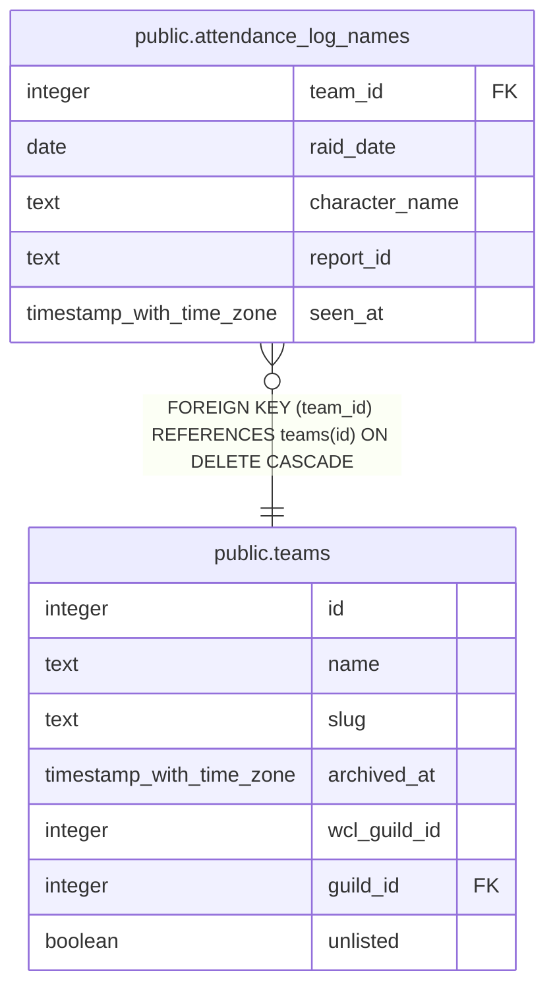

# public.attendance_log_names

## Description

Characters in a team's Warcraft Logs raid night who matched nobody on the roster (#1845). Written by wcl-sync; first name only, lower case, as the sync matches names. Informational: never holds back the attendance commit.

## Columns

| Name | Type | Default | Nullable | Children | Parents | Comment |
| ---- | ---- | ------- | -------- | -------- | ------- | ------- |
| team_id | integer |  | false |  | [public.teams](public.teams.md) |  |
| raid_date | date |  | false |  |  |  |
| character_name | text |  | false |  |  |  |
| report_id | text |  | false |  |  |  |
| seen_at | timestamp with time zone | now() | false |  |  |  |

## Constraints

| Name | Type | Definition |
| ---- | ---- | ---------- |
| attendance_log_names_team_id_fkey | FOREIGN KEY | FOREIGN KEY (team_id) REFERENCES teams(id) ON DELETE CASCADE |
| attendance_log_names_pkey | PRIMARY KEY | PRIMARY KEY (team_id, raid_date, character_name) |

## Indexes

| Name | Definition |
| ---- | ---------- |
| attendance_log_names_pkey | CREATE UNIQUE INDEX attendance_log_names_pkey ON public.attendance_log_names USING btree (team_id, raid_date, character_name) |

## Relations

---

> Generated by [tbls](https://github.com/k1LoW/tbls)
