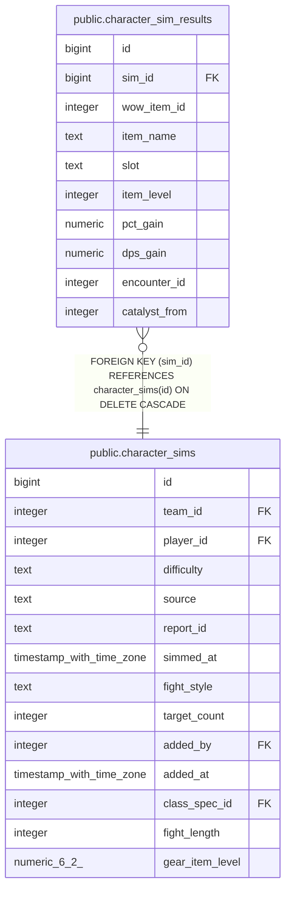

# public.character_sim_results

## Description

Each result in a sim (#1443): the item, the slot simmed into (Raidbots only), its item level and the gain in percent (and DPS for Raidbots).

## Columns

| Name | Type | Default | Nullable | Children | Parents | Comment |
| ---- | ---- | ------- | -------- | -------- | ------- | ------- |
| id | bigint |  | false |  |  |  |
| sim_id | bigint |  | false |  | [public.character_sims](public.character_sims.md) |  |
| wow_item_id | integer |  | false |  |  |  |
| item_name | text |  | true |  |  |  |
| slot | text |  | true |  |  |  |
| item_level | integer |  | false |  |  |  |
| pct_gain | numeric |  | false |  |  |  |
| dps_gain | numeric |  | true |  |  |  |
| encounter_id | integer |  | true |  |  |  |
| catalyst_from | integer |  | true |  |  |  |

## Constraints

| Name | Type | Definition |
| ---- | ---- | ---------- |
| character_sim_results_catalyst_from_check | CHECK | CHECK ((catalyst_from > 0)) |
| character_sim_results_dps_gain_check | CHECK | CHECK (((dps_gain >= ('-100000000'::integer)::numeric) AND (dps_gain <= (100000000)::numeric))) |
| character_sim_results_item_level_check | CHECK | CHECK (((item_level >= 1) AND (item_level <= 2000))) |
| character_sim_results_item_name_check | CHECK | CHECK ((char_length(item_name) <= 200)) |
| character_sim_results_pct_gain_check | CHECK | CHECK (((pct_gain >= ('-100'::integer)::numeric) AND (pct_gain <= (1000)::numeric))) |
| character_sim_results_slot_check | CHECK | CHECK ((char_length(slot) <= 20)) |
| character_sim_results_wow_item_id_check | CHECK | CHECK ((wow_item_id > 0)) |
| character_sim_results_sim_id_fkey | FOREIGN KEY | FOREIGN KEY (sim_id) REFERENCES character_sims(id) ON DELETE CASCADE |
| character_sim_results_pkey | PRIMARY KEY | PRIMARY KEY (id) |

## Indexes

| Name | Definition |
| ---- | ---------- |
| character_sim_results_pkey | CREATE UNIQUE INDEX character_sim_results_pkey ON public.character_sim_results USING btree (id) |
| character_sim_results_sim_id_idx | CREATE INDEX character_sim_results_sim_id_idx ON public.character_sim_results USING btree (sim_id) |

## Relations

---

> Generated by [tbls](https://github.com/k1LoW/tbls)
