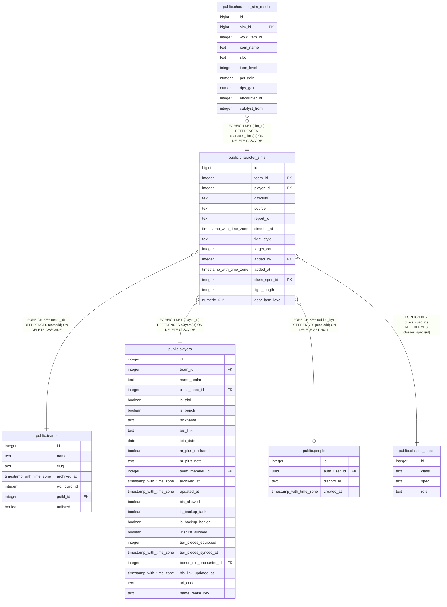

# public.character_sims

## Description

A raider's latest droptimizer sim per difficulty, spec and setup (#1443, #1916, #1888): Raidbots or QE Live, written by save_character_sim().

## Columns

| Name | Type | Default | Nullable | Children | Parents | Comment |
| ---- | ---- | ------- | -------- | -------- | ------- | ------- |
| id | bigint |  | false | [public.character_sim_results](public.character_sim_results.md) |  |  |
| team_id | integer |  | false |  | [public.teams](public.teams.md) |  |
| player_id | integer |  | false |  | [public.players](public.players.md) |  |
| difficulty | text |  | false |  |  |  |
| source | text |  | false |  |  |  |
| report_id | text |  | false |  |  |  |
| simmed_at | timestamp with time zone |  | false |  |  |  |
| fight_style | text |  | true |  |  |  |
| target_count | integer |  | true |  |  |  |
| added_by | integer |  | true |  | [public.people](public.people.md) |  |
| added_at | timestamp with time zone | now() | false |  |  |  |
| class_spec_id | integer |  | false |  | [public.classes_specs](public.classes_specs.md) | The spec the sim was run as (#1916). The character's roster spec's sim is the one the Priority page counts. |
| fight_length | integer |  | true |  |  | The fight length the sim was run at, in seconds (#1888); null for QE Live, and for sims saved before it was kept. |
| gear_item_level | numeric(6,2) |  | true |  |  | The raider's average equipped item level when the sim was saved, from the daily gear read (#1888); null when there was none. |

## Constraints

| Name | Type | Definition |
| ---- | ---- | ---------- |
| character_sims_difficulty_check | CHECK | CHECK ((difficulty = ANY (ARRAY['lfr'::text, 'normal'::text, 'heroic'::text, 'mythic'::text]))) |
| character_sims_fight_length_check | CHECK | CHECK (((fight_length >= 1) AND (fight_length <= 3600))) |
| character_sims_fight_style_check | CHECK | CHECK ((char_length(fight_style) <= 40)) |
| character_sims_gear_item_level_check | CHECK | CHECK (((gear_item_level >= (1)::numeric) AND (gear_item_level <= (2000)::numeric))) |
| character_sims_report_id_check | CHECK | CHECK ((report_id ~ '^[A-Za-z0-9_-]{1,64}$'::text)) |
| character_sims_source_check | CHECK | CHECK ((source = ANY (ARRAY['raidbots'::text, 'qe_live'::text]))) |
| character_sims_target_count_check | CHECK | CHECK (((target_count >= 1) AND (target_count <= 100))) |
| character_sims_class_spec_id_fkey | FOREIGN KEY | FOREIGN KEY (class_spec_id) REFERENCES classes_specs(id) |
| character_sims_player_id_fkey | FOREIGN KEY | FOREIGN KEY (player_id) REFERENCES players(id) ON DELETE CASCADE |
| character_sims_team_id_fkey | FOREIGN KEY | FOREIGN KEY (team_id) REFERENCES teams(id) ON DELETE CASCADE |
| character_sims_added_by_fkey | FOREIGN KEY | FOREIGN KEY (added_by) REFERENCES people(id) ON DELETE SET NULL |
| character_sims_pkey | PRIMARY KEY | PRIMARY KEY (id) |
| character_sims_player_setup_key | UNIQUE | UNIQUE NULLS NOT DISTINCT (player_id, difficulty, class_spec_id, fight_style, target_count, fight_length) |

## Indexes

| Name | Definition |
| ---- | ---------- |
| character_sims_pkey | CREATE UNIQUE INDEX character_sims_pkey ON public.character_sims USING btree (id) |
| character_sims_team_id_idx | CREATE INDEX character_sims_team_id_idx ON public.character_sims USING btree (team_id) |
| character_sims_player_setup_key | CREATE UNIQUE INDEX character_sims_player_setup_key ON public.character_sims USING btree (player_id, difficulty, class_spec_id, fight_style, target_count, fight_length) NULLS NOT DISTINCT |

## Relations

---

> Generated by [tbls](https://github.com/k1LoW/tbls)
