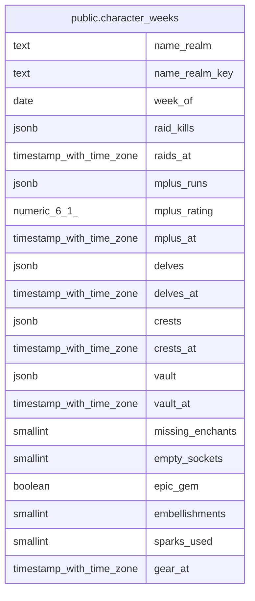

# public.character_weeks

## Description

The roster audit's weekly row (#1635, #1261): one per character (name_realm_key, as on players and characters) per week (week_of, the reset Tuesday). Each sync updates the current week's row; older weeks stay as last written. Each part carries when it was last written. Read by the character's teams and owner; written only by the syncs.

## Columns

| Name | Type | Default | Nullable | Extra Definition | Children | Parents | Comment |
| ---- | ---- | ------- | -------- | ---------------- | -------- | ------- | ------- |
| name_realm | text |  | false |  |  |  |  |
| name_realm_key | text |  | false | GENERATED ALWAYS AS lower(replace(name_realm, ' '::text, ''::text)) STORED |  |  |  |
| week_of | date |  | false |  |  |  | The reset Tuesday the week starts on. |
| raid_kills | jsonb | '[]'::jsonb | false |  |  |  | Bosses killed this week: [{"encounter_id": 2888, "instance_id": 1320, "difficulty": "mythic"}, ...], Blizzard journal ids. instance_id from #1637 on. |
| raids_at | timestamp with time zone |  | true |  |  |  |  |
| mplus_runs | jsonb | '[]'::jsonb | false |  |  |  |  |
| mplus_rating | numeric(6,1) |  | true |  |  |  |  |
| mplus_at | timestamp with time zone |  | true |  |  |  |  |
| delves | jsonb | '{}'::jsonb | false |  |  |  |  |
| delves_at | timestamp with time zone |  | true |  |  |  |  |
| crests | jsonb | '{}'::jsonb | false |  |  |  | Crests earned this season by track (season_crests.track), from the character statistics season_crests.statistic_id names. |
| crests_at | timestamp with time zone |  | true |  |  |  |  |
| vault | jsonb | '{}'::jsonb | false |  |  |  | The Great Vault worked out from this row (#1637, season_vault()): per row (raid, dungeon, world) its three slots. World is null unless both this week's and the week before's delves were read; Raid is null while a kill lacks its instance_id. |
| vault_at | timestamp with time zone |  | true |  |  |  |  |
| missing_enchants | smallint |  | true |  |  |  | Gear counts at the week's last gear sync (#1634): enchantable slots without a current-expansion enchant, empty sockets, whether an epic gem is worn, embellishments and sparks used. |
| empty_sockets | smallint |  | true |  |  |  |  |
| epic_gem | boolean |  | true |  |  |  |  |
| embellishments | smallint |  | true |  |  |  |  |
| sparks_used | smallint |  | true |  |  |  |  |
| gear_at | timestamp with time zone |  | true |  |  |  |  |

## Constraints

| Name | Type | Definition |
| ---- | ---- | ---------- |
| character_weeks_crests_check | CHECK | CHECK ((jsonb_typeof(crests) = 'object'::text)) |
| character_weeks_delves_check | CHECK | CHECK ((jsonb_typeof(delves) = 'object'::text)) |
| character_weeks_embellishments_check | CHECK | CHECK ((embellishments >= 0)) |
| character_weeks_empty_sockets_check | CHECK | CHECK ((empty_sockets >= 0)) |
| character_weeks_missing_enchants_check | CHECK | CHECK ((missing_enchants >= 0)) |
| character_weeks_mplus_rating_check | CHECK | CHECK ((mplus_rating >= (0)::numeric)) |
| character_weeks_mplus_runs_check | CHECK | CHECK ((jsonb_typeof(mplus_runs) = 'array'::text)) |
| character_weeks_name_realm_check | CHECK | CHECK ((name_realm ~ '\S'::text)) |
| character_weeks_raid_kills_check | CHECK | CHECK ((jsonb_typeof(raid_kills) = 'array'::text)) |
| character_weeks_sparks_used_check | CHECK | CHECK ((sparks_used >= 0)) |
| character_weeks_vault_check | CHECK | CHECK ((jsonb_typeof(vault) = 'object'::text)) |
| character_weeks_week_of_check | CHECK | CHECK ((EXTRACT(isodow FROM week_of) = (2)::numeric)) |
| character_weeks_pkey | PRIMARY KEY | PRIMARY KEY (name_realm_key, week_of) |

## Indexes

| Name | Definition |
| ---- | ---------- |
| character_weeks_pkey | CREATE UNIQUE INDEX character_weeks_pkey ON public.character_weeks USING btree (name_realm_key, week_of) |

## Triggers

| Name | Definition |
| ---- | ---------- |
| character_weeks_fill_vault | CREATE TRIGGER character_weeks_fill_vault BEFORE INSERT OR UPDATE ON public.character_weeks FOR EACH ROW EXECUTE FUNCTION character_weeks_fill_vault() |

## Relations

---

> Generated by [tbls](https://github.com/k1LoW/tbls)
