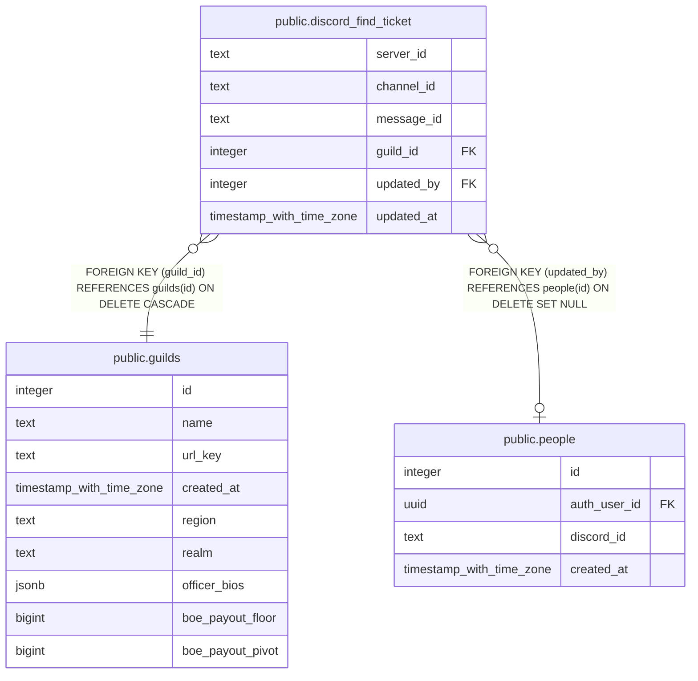

# public.discord_find_ticket

## Description

Find my ticket (#1542): per Discord server, the channel its message goes in and the message the bot posted, so the bot edits or removes that one. Read and written by the discord-settings Edge Function for whoever may edit recruiting for a team in the server. Service role only.

## Columns

| Name | Type | Default | Nullable | Children | Parents | Comment |
| ---- | ---- | ------- | -------- | -------- | ------- | ------- |
| server_id | text |  | false |  |  |  |
| channel_id | text |  | false |  |  |  |
| message_id | text |  | true |  |  | The posted message; null between picking the channel and the post going through. |
| guild_id | integer |  | false |  | [public.guilds](public.guilds.md) | The guild whose team first set it. Only that guild's teams move or remove it, so another guild's team pointed at the same server can't (Kat, 2026-11-10). |
| updated_by | integer |  | true |  | [public.people](public.people.md) | Who last picked the channel. |
| updated_at | timestamp with time zone | now() | false |  |  |  |

## Constraints

| Name | Type | Definition |
| ---- | ---- | ---------- |
| discord_find_ticket_channel_id | CHECK | CHECK ((channel_id ~ '^[0-9]{17,20}$'::text)) |
| discord_find_ticket_message_id | CHECK | CHECK ((message_id ~ '^[0-9]{17,20}$'::text)) |
| discord_find_ticket_server_id | CHECK | CHECK ((server_id ~ '^[0-9]{17,20}$'::text)) |
| discord_find_ticket_guild_id_fkey | FOREIGN KEY | FOREIGN KEY (guild_id) REFERENCES guilds(id) ON DELETE CASCADE |
| discord_find_ticket_updated_by_fkey | FOREIGN KEY | FOREIGN KEY (updated_by) REFERENCES people(id) ON DELETE SET NULL |
| discord_find_ticket_pkey | PRIMARY KEY | PRIMARY KEY (server_id) |

## Indexes

| Name | Definition |
| ---- | ---------- |
| discord_find_ticket_pkey | CREATE UNIQUE INDEX discord_find_ticket_pkey ON public.discord_find_ticket USING btree (server_id) |

## Triggers

| Name | Definition |
| ---- | ---------- |
| trg_discord_find_ticket_updated_at | CREATE TRIGGER trg_discord_find_ticket_updated_at BEFORE UPDATE ON public.discord_find_ticket FOR EACH ROW EXECUTE FUNCTION set_updated_at() |

## Relations

---

> Generated by [tbls](https://github.com/k1LoW/tbls)
