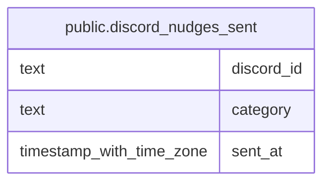

# public.discord_nudges_sent

## Description

When the bot last DMed each Discord user about each thing it chases: a missing wishlist, BiS link or BiS pick (/officer nudge-missing, #998) or a season signup (/officer missing-signups, #990). One row per Discord id and category, overwritten on each DM, so the 24-hour cooldown holds across every team. Written by discord-interactions with the service role, after the DM was sent.

## Columns

| Name | Type | Default | Nullable | Children | Parents | Comment |
| ---- | ---- | ------- | -------- | -------- | ------- | ------- |
| discord_id | text |  | false |  |  |  |
| category | text |  | false |  |  |  |
| sent_at | timestamp with time zone | now() | false |  |  |  |

## Constraints

| Name | Type | Definition |
| ---- | ---- | ---------- |
| discord_nudges_sent_category_check | CHECK | CHECK ((category = ANY (ARRAY['no-wishlist'::text, 'no-bis-link'::text, 'incomplete-wishlist'::text, 'signup-reminder'::text]))) |
| discord_nudges_sent_pkey | PRIMARY KEY | PRIMARY KEY (discord_id, category) |

## Indexes

| Name | Definition |
| ---- | ---------- |
| discord_nudges_sent_pkey | CREATE UNIQUE INDEX discord_nudges_sent_pkey ON public.discord_nudges_sent USING btree (discord_id, category) |

## Relations

---

> Generated by [tbls](https://github.com/k1LoW/tbls)
