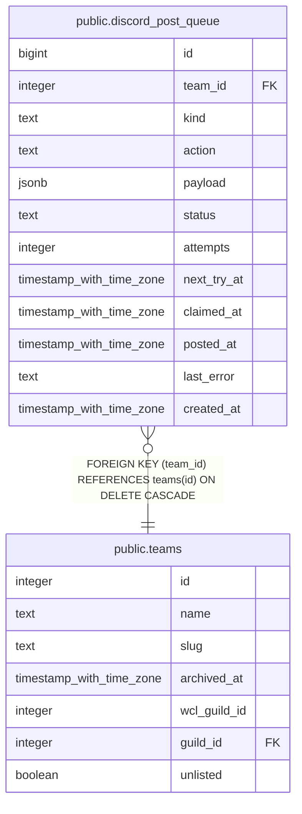

# public.discord_post_queue

## Description

Every Discord notice the bot posts to a team's channels, queued by the write behind it and posted by discord-bot-webhook's drain every minute (#962). Added only through queue_discord_post(), taken only through claim_discord_posts(). Service role only.

## Columns

| Name | Type | Default | Nullable | Children | Parents | Comment |
| ---- | ---- | ------- | -------- | -------- | ------- | ------- |
| id | bigint |  | false |  |  |  |
| team_id | integer |  | false |  | [public.teams](public.teams.md) |  |
| kind | text |  | false |  |  | The kind of post (team_discord_posts.kind) whose channel and ping role it uses, read when it posts. |
| action | text |  | false |  |  | What the notice is: the builder in discord-bot-webhook's posts.ts that turns payload into the message. |
| payload | jsonb |  | false |  |  | The fields the message is built from, written by the function that made the change from what it saved. |
| status | text | 'queued'::text | false |  |  | queued until it posts (posted), its kind of post is off or its team's server is gone when it comes up (skipped), or it fails five times (failed). |
| attempts | integer | 0 | false |  |  |  |
| next_try_at | timestamp with time zone | now() | false |  |  | When it may post: now when queued, later after a failed try, or, for a batched RSVP change, when its batched post is due (#1710). Changing a team's RSVP timing brings its waiting changes forward, so the next run decides them again. |
| claimed_at | timestamp with time zone |  | true |  |  | When a posting run took it. A run that dies holding it frees it after ten minutes. |
| posted_at | timestamp with time zone |  | true |  |  |  |
| last_error | text |  | true |  |  | Why the last try did not post. |
| created_at | timestamp with time zone | now() | false |  |  |  |

## Constraints

| Name | Type | Definition |
| ---- | ---- | ---------- |
| discord_post_queue_action_check | CHECK | CHECK ((action = ANY (ARRAY['signup'::text, 'addCharacter'::text, 'selfreceived'::text, 'bis'::text, 'mplus'::text, 'rsvp'::text, 'mainswap'::text]))) |
| discord_post_queue_kind_check | CHECK | CHECK ((kind = ANY (ARRAY['officer_requests'::text, 'mplus_requests'::text, 'rsvp_changes'::text]))) |
| discord_post_queue_status_check | CHECK | CHECK ((status = ANY (ARRAY['queued'::text, 'posted'::text, 'skipped'::text, 'failed'::text]))) |
| discord_post_queue_team_id_fkey | FOREIGN KEY | FOREIGN KEY (team_id) REFERENCES teams(id) ON DELETE CASCADE |
| discord_post_queue_pkey | PRIMARY KEY | PRIMARY KEY (id) |

## Indexes

| Name | Definition |
| ---- | ---------- |
| discord_post_queue_pkey | CREATE UNIQUE INDEX discord_post_queue_pkey ON public.discord_post_queue USING btree (id) |
| discord_post_queue_queued | CREATE INDEX discord_post_queue_queued ON public.discord_post_queue USING btree (id) WHERE (status = 'queued'::text) |
| discord_post_queue_team | CREATE INDEX discord_post_queue_team ON public.discord_post_queue USING btree (team_id, created_at) |

## Relations

---

> Generated by [tbls](https://github.com/k1LoW/tbls)
