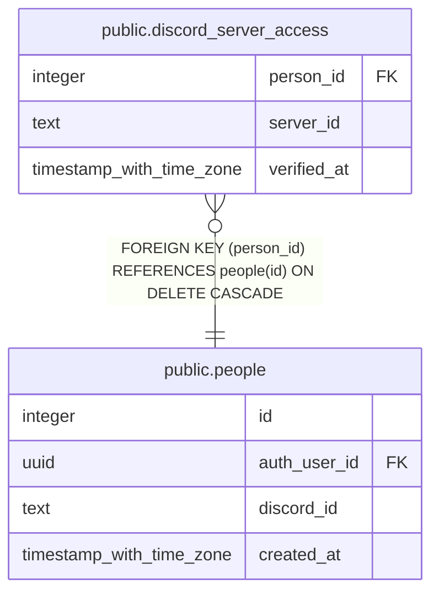

# public.discord_server_access

## Description

Discord servers a person and the bot were both found in, and when (#1712). Written with the service key by the function that reads Discord (#994); set_team_discord_server() takes only a server verified for the caller in the last hour.

## Columns

| Name | Type | Default | Nullable | Children | Parents | Comment |
| ---- | ---- | ------- | -------- | -------- | ------- | ------- |
| person_id | integer |  | false |  | [public.people](public.people.md) |  |
| server_id | text |  | false |  |  |  |
| verified_at | timestamp with time zone | now() | false |  |  |  |

## Constraints

| Name | Type | Definition |
| ---- | ---- | ---------- |
| discord_server_access_person_id_fkey | FOREIGN KEY | FOREIGN KEY (person_id) REFERENCES people(id) ON DELETE CASCADE |
| discord_server_access_pkey | PRIMARY KEY | PRIMARY KEY (person_id, server_id) |

## Indexes

| Name | Definition |
| ---- | ---------- |
| discord_server_access_pkey | CREATE UNIQUE INDEX discord_server_access_pkey ON public.discord_server_access USING btree (person_id, server_id) |

## Relations

---

> Generated by [tbls](https://github.com/k1LoW/tbls)
