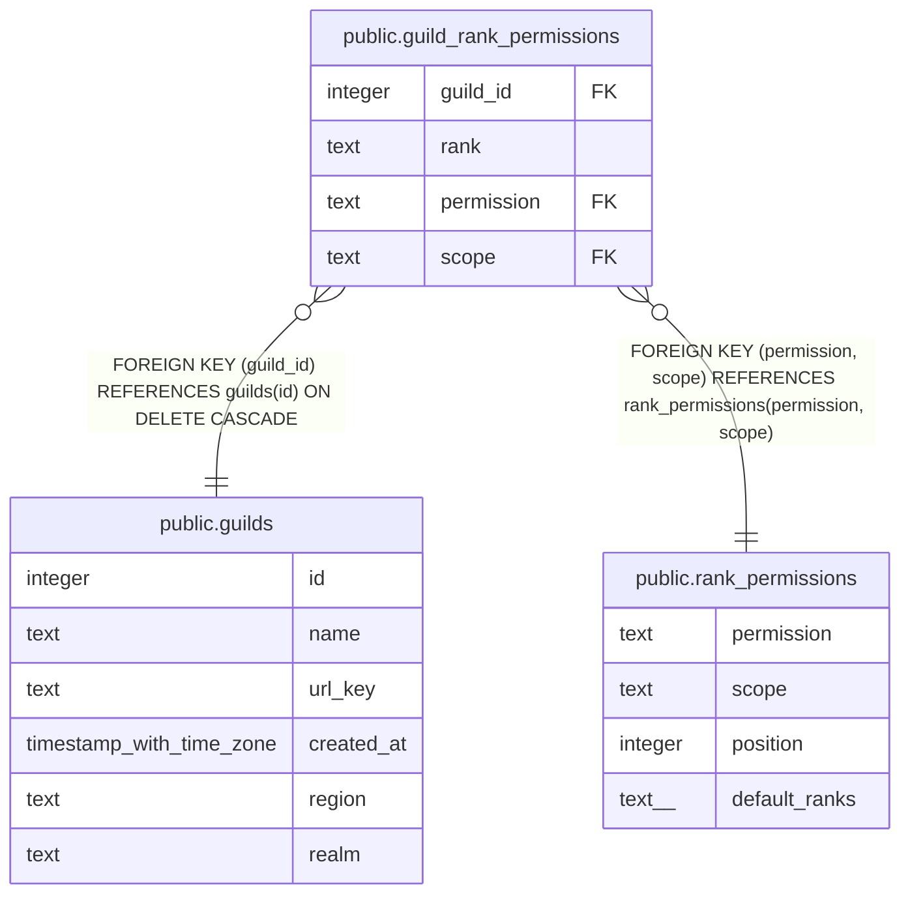

# public.guild_rank_permissions

## Description

Each guild's grid: a row means that guild rank has that permission there (#1645). Filled from rank_permissions.default_ranks when the guild is made; the Owner changes it later.

## Columns

| Name | Type | Default | Nullable | Children | Parents | Comment |
| ---- | ---- | ------- | -------- | -------- | ------- | ------- |
| guild_id | integer |  | false |  | [public.guilds](public.guilds.md) |  |
| rank | text |  | false |  |  |  |
| permission | text |  | false |  | [public.rank_permissions](public.rank_permissions.md) |  |
| scope | text | 'guild'::text | false |  | [public.rank_permissions](public.rank_permissions.md) |  |

## Constraints

| Name | Type | Definition |
| ---- | ---- | ---------- |
| guild_rank_permissions_rank_check | CHECK | CHECK ((rank = ANY (ARRAY['member'::text, 'team_lead'::text, 'admin'::text]))) |
| guild_rank_permissions_scope_check | CHECK | CHECK ((scope = 'guild'::text)) |
| guild_rank_permissions_guild_id_fkey | FOREIGN KEY | FOREIGN KEY (guild_id) REFERENCES guilds(id) ON DELETE CASCADE |
| guild_rank_permissions_permission_scope_fkey | FOREIGN KEY | FOREIGN KEY (permission, scope) REFERENCES rank_permissions(permission, scope) |
| guild_rank_permissions_pkey | PRIMARY KEY | PRIMARY KEY (guild_id, rank, permission) |

## Indexes

| Name | Definition |
| ---- | ---------- |
| guild_rank_permissions_pkey | CREATE UNIQUE INDEX guild_rank_permissions_pkey ON public.guild_rank_permissions USING btree (guild_id, rank, permission) |

## Relations

---

> Generated by [tbls](https://github.com/k1LoW/tbls)
