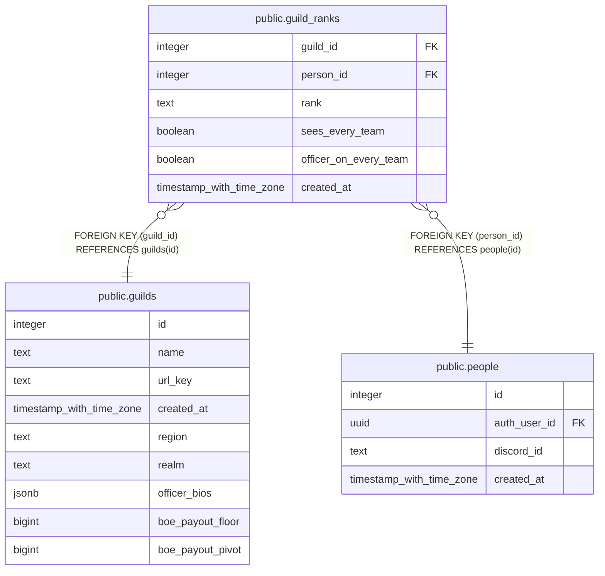

# public.guild_ranks

## Description

A person's rank in a guild (#1645): owner (one per guild), admin, team_lead or member. Member is automatic for anyone on a team in the guild, so a member has a row only to hold one of the two switches. Owner and admin are kept in step with a guild_officer grant until cutover, both ways.

## Columns

| Name | Type | Default | Nullable | Children | Parents | Comment |
| ---- | ---- | ------- | -------- | -------- | ------- | ------- |
| guild_id | integer |  | false |  | [public.guilds](public.guilds.md) |  |
| person_id | integer |  | false |  | [public.people](public.people.md) |  |
| rank | text | 'member'::text | false |  |  |  |
| sees_every_team | boolean | false | false |  |  | "See every team, read-only" (#1517): set by the guild Owner per person. Off for everyone; the read rules that use it come later. |
| officer_on_every_team | boolean | false | false |  |  | "Officer on every team" (#1517): set by the guild Owner per person. While on, has_team_permission() answers as an Officer on every team in the guild. |
| created_at | timestamp with time zone | now() | false |  |  |  |

## Constraints

| Name | Type | Definition |
| ---- | ---- | ---------- |
| guild_ranks_rank_check | CHECK | CHECK ((rank = ANY (ARRAY['owner'::text, 'admin'::text, 'team_lead'::text, 'member'::text]))) |
| guild_ranks_guild_id_fkey | FOREIGN KEY | FOREIGN KEY (guild_id) REFERENCES guilds(id) |
| guild_ranks_person_id_fkey | FOREIGN KEY | FOREIGN KEY (person_id) REFERENCES people(id) |
| guild_ranks_pkey | PRIMARY KEY | PRIMARY KEY (guild_id, person_id) |

## Indexes

| Name | Definition |
| ---- | ---------- |
| guild_ranks_pkey | CREATE UNIQUE INDEX guild_ranks_pkey ON public.guild_ranks USING btree (guild_id, person_id) |
| guild_ranks_one_owner | CREATE UNIQUE INDEX guild_ranks_one_owner ON public.guild_ranks USING btree (guild_id) WHERE (rank = 'owner'::text) |
| guild_ranks_person_id_idx | CREATE INDEX guild_ranks_person_id_idx ON public.guild_ranks USING btree (person_id) |

## Triggers

| Name | Definition |
| ---- | ---------- |
| guild_ranks_keep_grant | CREATE TRIGGER guild_ranks_keep_grant AFTER INSERT OR DELETE OR UPDATE OF rank ON public.guild_ranks FOR EACH ROW EXECUTE FUNCTION guild_ranks_keep_grant() |

## Relations

---

> Generated by [tbls](https://github.com/k1LoW/tbls)
