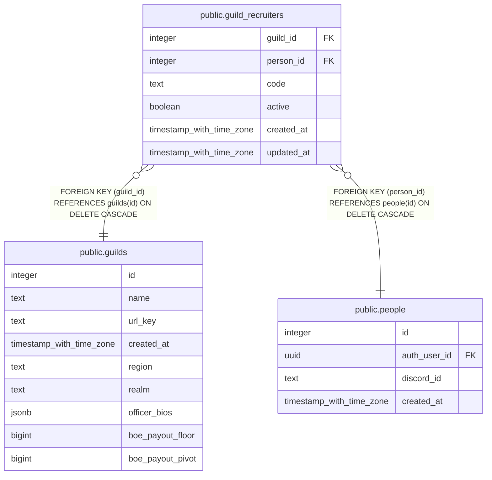

# public.guild_recruiters

## Description

A guild's recruiters (#1537): one row per person per guild, with the code in their apply links (?from=<code>) and whether they are switched on. Switched off keeps the row and its code. Changed only through set_guild_recruiter(); read through guild_recruiter_list(), recruiter_for_code() and guild_active_recruiters().

## Columns

| Name | Type | Default | Nullable | Children | Parents | Comment |
| ---- | ---- | ------- | -------- | -------- | ------- | ------- |
| guild_id | integer |  | false |  | [public.guilds](public.guilds.md) |  |
| person_id | integer |  | false |  | [public.people](public.people.md) |  |
| code | text | new_url_code() | false |  |  | The code in the recruiter's apply links. Random, unique site-wide, and fixed once issued so links already posted keep working; never the recruiter's name. |
| active | boolean | true | false |  |  | Off: the code stops crediting new applications. Past applications keep the recruiter. |
| created_at | timestamp with time zone | now() | false |  |  |  |
| updated_at | timestamp with time zone | now() | false |  |  |  |

## Constraints

| Name | Type | Definition |
| ---- | ---- | ---------- |
| guild_recruiters_code_format | CHECK | CHECK ((code ~ '^[a-z0-9]{8}$'::text)) |
| guild_recruiters_guild_id_fkey | FOREIGN KEY | FOREIGN KEY (guild_id) REFERENCES guilds(id) ON DELETE CASCADE |
| guild_recruiters_person_id_fkey | FOREIGN KEY | FOREIGN KEY (person_id) REFERENCES people(id) ON DELETE CASCADE |
| guild_recruiters_pkey | PRIMARY KEY | PRIMARY KEY (guild_id, person_id) |
| guild_recruiters_code_key | UNIQUE | UNIQUE (code) |

## Indexes

| Name | Definition |
| ---- | ---------- |
| guild_recruiters_pkey | CREATE UNIQUE INDEX guild_recruiters_pkey ON public.guild_recruiters USING btree (guild_id, person_id) |
| guild_recruiters_code_key | CREATE UNIQUE INDEX guild_recruiters_code_key ON public.guild_recruiters USING btree (code) |

## Relations

---

> Generated by [tbls](https://github.com/k1LoW/tbls)
