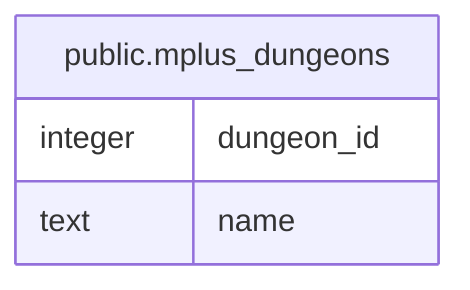

# public.mplus_dungeons

## Description

Mythic+ dungeon names by the dungeon id the profile API uses, Blizzard's MapChallengeMode id (#1641). Every dungeon, not a season's pool.

## Columns

| Name | Type | Default | Nullable | Children | Parents | Comment |
| ---- | ---- | ------- | -------- | -------- | ------- | ------- |
| dungeon_id | integer |  | false |  |  |  |
| name | text |  | false |  |  |  |

## Constraints

| Name | Type | Definition |
| ---- | ---- | ---------- |
| mplus_dungeons_dungeon_id_check | CHECK | CHECK ((dungeon_id > 0)) |
| mplus_dungeons_name_check | CHECK | CHECK ((name ~ '\S'::text)) |
| mplus_dungeons_pkey | PRIMARY KEY | PRIMARY KEY (dungeon_id) |

## Indexes

| Name | Definition |
| ---- | ---------- |
| mplus_dungeons_pkey | CREATE UNIQUE INDEX mplus_dungeons_pkey ON public.mplus_dungeons USING btree (dungeon_id) |

## Relations

---

> Generated by [tbls](https://github.com/k1LoW/tbls)
