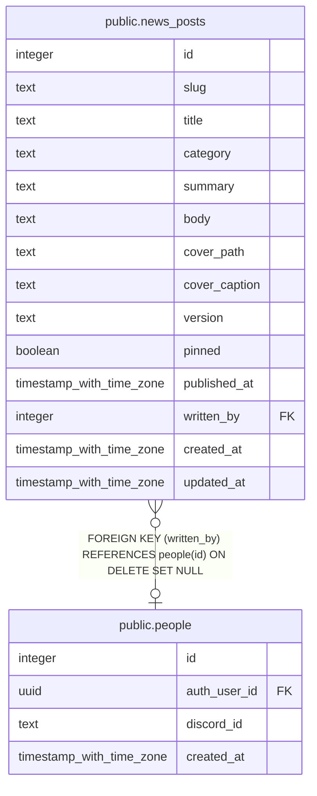

# public.news_posts

## Description

News posts (#1523), site-wide. published_at null: a draft, which only Staff (is_site_admin()) read. Written by Staff on the site (#1230); the news.json entries were copied in by this table's migration.

## Columns

| Name | Type | Default | Nullable | Children | Parents | Comment |
| ---- | ---- | ------- | -------- | -------- | ------- | ------- |
| id | integer |  | false |  |  |  |
| slug | text |  | false |  |  | The post's address, /news/\<slug\>, for links from Discord. Lowercase words joined by hyphens; kept when the title changes. |
| title | text |  | false |  |  |  |
| category | text |  | false |  |  |  |
| summary | text |  | false |  |  | One line for the News timeline and the Guild home teaser. |
| body | text | ''::text | false |  |  | Simple formatting: ## headings, **bold**, - lists, [links](url) and . |
| cover_path | text |  | true |  |  | The cover picture's path in the news-pictures bucket; null for none. |
| cover_caption | text |  | true |  |  |  |
| version | text |  | true |  |  | The site version the post went out with, for the copied news.json entries; optional on a new post. |
| pinned | boolean | false | false |  |  |  |
| published_at | timestamp with time zone |  | true |  |  | When the post was published; null while it is a draft; a date still to come keeps it hidden until then. The copied entries carry their news.json date at noon Eastern. |
| written_by | integer | my_person_id() | true |  | [public.people](public.people.md) | The person who wrote the post: the caller, set on insert. |
| created_at | timestamp with time zone | now() | false |  |  |  |
| updated_at | timestamp with time zone | now() | false |  |  | The last edit. |

## Constraints

| Name | Type | Definition |
| ---- | ---- | ---------- |
| news_posts_category_check | CHECK | CHECK ((category = ANY (ARRAY['Feature'::text, 'Fix'::text, 'Change'::text, 'Announcement'::text]))) |
| news_posts_slug_check | CHECK | CHECK ((slug ~ '^[a-z0-9]+(-[a-z0-9]+)*$'::text)) |
| news_posts_summary_check | CHECK | CHECK ((summary ~ '\S'::text)) |
| news_posts_title_check | CHECK | CHECK ((title ~ '\S'::text)) |
| news_posts_written_by_fkey | FOREIGN KEY | FOREIGN KEY (written_by) REFERENCES people(id) ON DELETE SET NULL |
| news_posts_pkey | PRIMARY KEY | PRIMARY KEY (id) |
| news_posts_slug_key | UNIQUE | UNIQUE (slug) |

## Indexes

| Name | Definition |
| ---- | ---------- |
| news_posts_pkey | CREATE UNIQUE INDEX news_posts_pkey ON public.news_posts USING btree (id) |
| news_posts_slug_key | CREATE UNIQUE INDEX news_posts_slug_key ON public.news_posts USING btree (slug) |
| news_posts_published_idx | CREATE INDEX news_posts_published_idx ON public.news_posts USING btree (published_at DESC) WHERE (published_at IS NOT NULL) |

## Triggers

| Name | Definition |
| ---- | ---------- |
| trg_news_posts_updated_at | CREATE TRIGGER trg_news_posts_updated_at BEFORE UPDATE ON public.news_posts FOR EACH ROW EXECUTE FUNCTION set_updated_at() |

## Relations

---

> Generated by [tbls](https://github.com/k1LoW/tbls)
