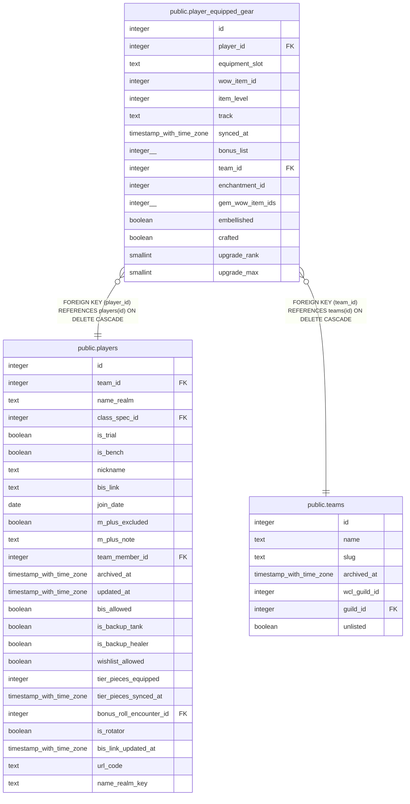

# public.player_equipped_gear

## Description

One row per player per physical gear slot (Blizzard API slot keys: HEAD, FINGER_1, FINGER_2, ...), synced from the Blizzard Character Equipment Summary endpoint. Feeds generate_priority_order()'s equipped-item-level fairness factor.

## Columns

| Name | Type | Default | Nullable | Children | Parents | Comment |
| ---- | ---- | ------- | -------- | -------- | ------- | ------- |
| id | integer | nextval('player_equipped_gear_id_seq'::regclass) | false |  |  |  |
| player_id | integer |  | false |  | [public.players](public.players.md) |  |
| equipment_slot | text |  | false |  |  |  |
| wow_item_id | integer |  | true |  |  | Blizzard's item id for the equipped item, as the Character Equipment Summary returns it: the same numbers as items.wow_item_id, not items.id. Null when Blizzard sent none. |
| item_level | integer |  | true |  |  |  |
| track | text |  | true |  |  | Gear upgrade track (Explorer/Adventurer/Veteran/Champion/Hero/Myth), derived from bonus_list via track_bonus_ids. Falls back to the item level against the current tier's season_track_floors only when no bonus ID matches (crafted, Timewarped and similar gear carries no track bonus ID) -- that fallback cannot distinguish overlapping tracks and is a last resort, not the primary source. |
| synced_at | timestamp with time zone | now() | false |  |  |  |
| bonus_list | integer[] |  | true |  |  | The item's bonus IDs exactly as the Blizzard Character Equipment Summary returned them. track is derived from these via track_bonus_ids; kept raw so it can be re-derived without a re-sync. |
| team_id | integer |  | false |  | [public.teams](public.teams.md) |  |
| enchantment_id | integer |  | true |  |  | The permanent enchant's Blizzard enchantment id (season_enchants.enchantment_id), null when there is none. Temporary ones (oils, whetstones, Illusory Adornments) are never stored. Synced by blizzard-gear-sync (#1634). |
| gem_wow_item_ids | integer[] | '{}'::integer[] | false |  |  | One entry per socket the item has, in order: the gem's Blizzard item id (season_gems.wow_item_id), or null for an empty socket. Empty array when the item has no sockets. Synced by blizzard-gear-sync (#1634). |
| embellished | boolean | false | false |  |  | The item carries an embellishment (its equip limit is "Embellished"). Synced by blizzard-gear-sync (#1634). |
| crafted | boolean | false | false |  |  | The item was crafted. Synced by blizzard-gear-sync (#1634). |
| upgrade_rank | smallint |  | true |  |  | The item's step on its track (the 4 of Hero 4/6), from its track bonus id in track_bonus_ids. Null when none matched. Synced by blizzard-gear-sync (#1634). |
| upgrade_max | smallint |  | true |  |  | The top step of the item's track that season (the 6 of Hero 4/6): the end of the track's unbroken steps from 1, so the Mythic bosses' special drop reads 9 of 6, as in game. Null exactly when upgrade_rank is. Synced by blizzard-gear-sync (#1634). |

## Constraints

| Name | Type | Definition |
| ---- | ---- | ---------- |
| player_equipped_gear_enchantment_id_check | CHECK | CHECK ((enchantment_id > 0)) |
| player_equipped_gear_upgrade_max_check | CHECK | CHECK ((upgrade_max > 0)) |
| player_equipped_gear_upgrade_rank_check | CHECK | CHECK ((upgrade_rank > 0)) |
| player_equipped_gear_upgrade_step_check | CHECK | CHECK (((upgrade_rank IS NULL) = (upgrade_max IS NULL))) |
| player_equipped_gear_player_id_fkey | FOREIGN KEY | FOREIGN KEY (player_id) REFERENCES players(id) ON DELETE CASCADE |
| player_equipped_gear_team_id_fkey | FOREIGN KEY | FOREIGN KEY (team_id) REFERENCES teams(id) ON DELETE CASCADE |
| player_equipped_gear_pkey | PRIMARY KEY | PRIMARY KEY (id) |
| player_equipped_gear_player_id_equipment_slot_key | UNIQUE | UNIQUE (player_id, equipment_slot) |

## Indexes

| Name | Definition |
| ---- | ---------- |
| player_equipped_gear_pkey | CREATE UNIQUE INDEX player_equipped_gear_pkey ON public.player_equipped_gear USING btree (id) |
| player_equipped_gear_player_id_equipment_slot_key | CREATE UNIQUE INDEX player_equipped_gear_player_id_equipment_slot_key ON public.player_equipped_gear USING btree (player_id, equipment_slot) |

## Triggers

| Name | Definition |
| ---- | ---------- |
| trg_player_equipped_gear_team_id_check | CREATE TRIGGER trg_player_equipped_gear_team_id_check BEFORE INSERT OR UPDATE ON public.player_equipped_gear FOR EACH ROW EXECUTE FUNCTION check_team_id_matches_player() |

## Relations

---

> Generated by [tbls](https://github.com/k1LoW/tbls)
