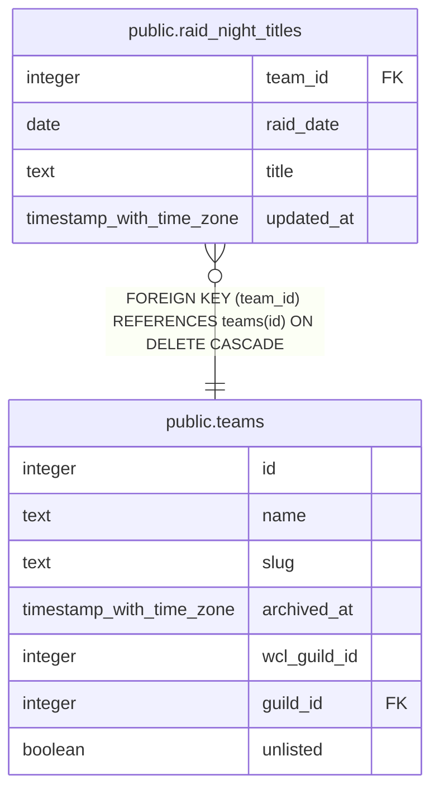

# public.raid_night_titles

## Description

A title for one raid date (#1478): "Rename this night" on the night's page. It covers every night on that date and wins over raid_schedule.title; the next week goes back to the weekly title. Written by the officers who write raid_schedule.

## Columns

| Name | Type | Default | Nullable | Children | Parents | Comment |
| ---- | ---- | ------- | -------- | -------- | ------- | ------- |
| team_id | integer |  | false |  | [public.teams](public.teams.md) |  |
| raid_date | date |  | false |  |  |  |
| title | text |  | false |  |  |  |
| updated_at | timestamp with time zone | now() | false |  |  |  |

## Constraints

| Name | Type | Definition |
| ---- | ---- | ---------- |
| raid_night_titles_title_check | CHECK | CHECK ((((char_length(title) >= 1) AND (char_length(title) <= 40)) AND (title = btrim(title)))) |
| raid_night_titles_team_id_fkey | FOREIGN KEY | FOREIGN KEY (team_id) REFERENCES teams(id) ON DELETE CASCADE |
| raid_night_titles_pkey | PRIMARY KEY | PRIMARY KEY (team_id, raid_date) |

## Indexes

| Name | Definition |
| ---- | ---------- |
| raid_night_titles_pkey | CREATE UNIQUE INDEX raid_night_titles_pkey ON public.raid_night_titles USING btree (team_id, raid_date) |

## Triggers

| Name | Definition |
| ---- | ---------- |
| trg_raid_night_titles_updated_at | CREATE TRIGGER trg_raid_night_titles_updated_at BEFORE UPDATE ON public.raid_night_titles FOR EACH ROW EXECUTE FUNCTION set_updated_at() |

## Relations

---

> Generated by [tbls](https://github.com/k1LoW/tbls)
