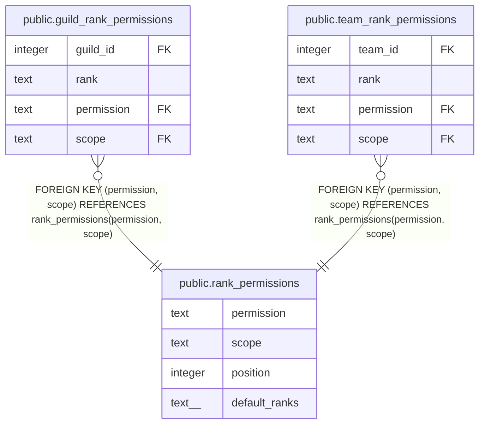

# public.rank_permissions

## Description

Every permission on the guild and team grids, with the ranks that have it in a new guild or team (#1517, #1645). Owners hold every permission and are not listed.

## Columns

| Name | Type | Default | Nullable | Children | Parents | Comment |
| ---- | ---- | ------- | -------- | -------- | ------- | ------- |
| permission | text |  | false | [public.guild_rank_permissions](public.guild_rank_permissions.md) [public.team_rank_permissions](public.team_rank_permissions.md) |  |  |
| scope | text |  | false | [public.guild_rank_permissions](public.guild_rank_permissions.md) [public.team_rank_permissions](public.team_rank_permissions.md) |  |  |
| position | integer |  | false |  |  |  |
| default_ranks | text[] |  | false |  |  |  |

## Constraints

| Name | Type | Definition |
| ---- | ---- | ---------- |
| rank_permissions_scope_check | CHECK | CHECK ((scope = ANY (ARRAY['guild'::text, 'team'::text]))) |
| rank_permissions_pkey | PRIMARY KEY | PRIMARY KEY (permission) |
| rank_permissions_permission_scope_key | UNIQUE | UNIQUE (permission, scope) |

## Indexes

| Name | Definition |
| ---- | ---------- |
| rank_permissions_pkey | CREATE UNIQUE INDEX rank_permissions_pkey ON public.rank_permissions USING btree (permission) |
| rank_permissions_permission_scope_key | CREATE UNIQUE INDEX rank_permissions_permission_scope_key ON public.rank_permissions USING btree (permission, scope) |

## Relations

---

> Generated by [tbls](https://github.com/k1LoW/tbls)
