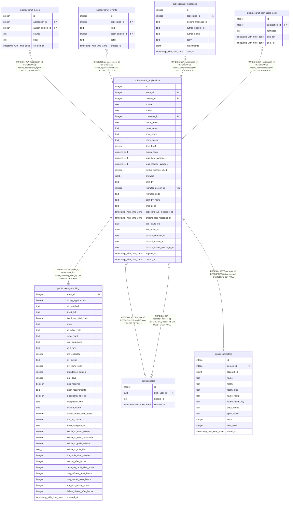

# public.recruit_applications

## Description

Recruit records (#1539): one per person per team per attempt, sent from the form (source application) or added by an officer for a ticket-only applicant (added_by_officer). The character columns are a copy taken when sent. One open (closed_at null) per person per team. Read and written through functions; the bot writes the Discord ids and last-message times with the service key.

## Columns

| Name | Type | Default | Nullable | Children | Parents | Comment |
| ---- | ---- | ------- | -------- | -------- | ------- | ------- |
| id | integer |  | false | [public.recruit_notes](public.recruit_notes.md) [public.recruit_events](public.recruit_events.md) [public.recruit_messages](public.recruit_messages.md) [public.recruit_reminders_sent](public.recruit_reminders_sent.md) |  |  |
| team_id | integer |  | false |  | [public.team_recruiting](public.team_recruiting.md) |  |
| person_id | integer |  | true |  | [public.people](public.people.md) |  |
| source | text |  | false |  |  |  |
| status | text | 'waiting_on_officers'::text | false |  |  | waiting_on_officers and waiting_on_applicant follow the last-message times (recruit_applications_whose_turn); on_trial, joined and not_joining are #1793's; declined, no_reply and withdrawn close it. |
| character_id | integer |  | true |  | [public.characters](public.characters.md) |  |
| name_realm | text |  | false |  |  |  |
| class_name | text |  | true |  |  |  |
| spec_name | text |  | true |  |  |  |
| other_specs | text[] | '{}'::text[] | false |  |  |  |
| item_level | integer |  | true |  |  |  |
| mplus_score | numeric(6,1) |  | true |  |  |  |
| logs_best_average | numeric(4,1) |  | true |  |  |  |
| logs_median_average | numeric(4,1) |  | true |  |  |  |
| mythic_bosses_killed | integer |  | true |  |  |  |
| answers | jsonb | '[]'::jsonb | false |  |  | The answers in form order, each {key or question_id, label, prompt, answer_type, answer}, with the question's wording as it was when sent. A picture answer is its path in the application-pictures bucket. |
| sent_by | text | 'nobody'::text | false |  |  |  |
| recruiter_person_id | integer |  | true |  | [public.people](public.people.md) |  |
| recruiter_code | text |  | true |  |  |  |
| sent_by_name | text |  | true |  |  |  |
| time_zone | text |  | true |  |  | The applicant's time zone, from their browser, so reminders never DM them overnight. |
| applicant_last_message_at | timestamp with time zone |  | true |  |  |  |
| officers_last_message_at | timestamp with time zone |  | true |  |  |  |
| trial_starts_on | date |  | true |  |  |  |
| trial_ends_on | date |  | true |  |  |  |
| discord_channel_id | text |  | true |  |  |  |
| discord_thread_id | text |  | true |  |  |  |
| discord_officer_message_id | text |  | true |  |  |  |
| applied_at | timestamp with time zone | now() | false |  |  |  |
| closed_at | timestamp with time zone |  | true |  |  |  |

## Constraints

| Name | Type | Definition |
| ---- | ---- | ---------- |
| recruit_applications_answers | CHECK | CHECK ((jsonb_typeof(answers) = 'array'::text)) |
| recruit_applications_class_name | CHECK | CHECK ((char_length(class_name) <= 30)) |
| recruit_applications_closed | CHECK | CHECK (((status = ANY (ARRAY['joined'::text, 'declined'::text, 'not_joining'::text, 'no_reply'::text, 'withdrawn'::text])) = (closed_at IS NOT NULL))) |
| recruit_applications_discord_channel_id | CHECK | CHECK ((discord_channel_id ~ '^[0-9]{17,20}$'::text)) |
| recruit_applications_discord_officer_message_id | CHECK | CHECK ((discord_officer_message_id ~ '^[0-9]{17,20}$'::text)) |
| recruit_applications_discord_thread_id | CHECK | CHECK ((discord_thread_id ~ '^[0-9]{17,20}$'::text)) |
| recruit_applications_item_level | CHECK | CHECK (((item_level >= 1) AND (item_level <= 1000))) |
| recruit_applications_logs_best_average | CHECK | CHECK (((logs_best_average >= (0)::numeric) AND (logs_best_average <= (100)::numeric))) |
| recruit_applications_logs_median_average | CHECK | CHECK (((logs_median_average >= (0)::numeric) AND (logs_median_average <= (100)::numeric))) |
| recruit_applications_mplus_score | CHECK | CHECK ((mplus_score >= (0)::numeric)) |
| recruit_applications_mythic_bosses_killed | CHECK | CHECK ((mythic_bosses_killed >= 0)) |
| recruit_applications_name_realm | CHECK | CHECK (((char_length(name_realm) <= 100) AND (name_realm ~ '^[^\s-][^-]*-\S'::text) AND (name_realm !~ '[\r\n]'::text))) |
| recruit_applications_on_trial_dated | CHECK | CHECK (((status <> 'on_trial'::text) OR (trial_ends_on IS NOT NULL))) |
| recruit_applications_other_specs | CHECK | CHECK (((cardinality(other_specs) <= 4) AND text_items_match(other_specs, '^[^\r\n]{1,30}$'::text))) |
| recruit_applications_recruiter_code | CHECK | CHECK ((recruiter_code ~ '^[a-z0-9]{8}$'::text)) |
| recruit_applications_sent_by | CHECK | CHECK ((sent_by = ANY (ARRAY['recruiter'::text, 'friend'::text, 'nobody'::text]))) |
| recruit_applications_sent_by_name | CHECK | CHECK (((char_length(sent_by_name) <= 100) AND (sent_by_name ~ '\S'::text) AND (sent_by_name !~ '[\r\n]'::text))) |
| recruit_applications_sent_by_shape | CHECK | CHECK (COALESCE( CASE sent_by     WHEN 'recruiter'::text THEN ((recruiter_code IS NOT NULL) AND (sent_by_name IS NOT NULL))     WHEN 'friend'::text THEN ((sent_by_name IS NOT NULL) AND (recruiter_code IS NULL) AND (recruiter_person_id IS NULL))     ELSE ((sent_by_name IS NULL) AND (recruiter_code IS NULL) AND (recruiter_person_id IS NULL)) END, false)) |
| recruit_applications_source | CHECK | CHECK ((source = ANY (ARRAY['application'::text, 'added_by_officer'::text]))) |
| recruit_applications_spec_name | CHECK | CHECK ((char_length(spec_name) <= 30)) |
| recruit_applications_status | CHECK | CHECK ((status = ANY (ARRAY['waiting_on_officers'::text, 'waiting_on_applicant'::text, 'on_trial'::text, 'joined'::text, 'declined'::text, 'not_joining'::text, 'no_reply'::text, 'withdrawn'::text]))) |
| recruit_applications_time_zone | CHECK | CHECK ((char_length(time_zone) <= 64)) |
| recruit_applications_trial_dates | CHECK | CHECK ((((trial_starts_on IS NULL) = (trial_ends_on IS NULL)) AND COALESCE((trial_ends_on >= trial_starts_on), true))) |
| recruit_applications_person_id_fkey | FOREIGN KEY | FOREIGN KEY (person_id) REFERENCES people(id) ON DELETE SET NULL |
| recruit_applications_recruiter_person_id_fkey | FOREIGN KEY | FOREIGN KEY (recruiter_person_id) REFERENCES people(id) ON DELETE SET NULL |
| recruit_applications_character_id_fkey | FOREIGN KEY | FOREIGN KEY (character_id) REFERENCES characters(id) ON DELETE SET NULL |
| recruit_applications_team_id_fkey | FOREIGN KEY | FOREIGN KEY (team_id) REFERENCES team_recruiting(team_id) ON DELETE CASCADE |
| recruit_applications_pkey | PRIMARY KEY | PRIMARY KEY (id) |

## Indexes

| Name | Definition |
| ---- | ---------- |
| recruit_applications_pkey | CREATE UNIQUE INDEX recruit_applications_pkey ON public.recruit_applications USING btree (id) |
| recruit_applications_one_open | CREATE UNIQUE INDEX recruit_applications_one_open ON public.recruit_applications USING btree (team_id, person_id) WHERE (closed_at IS NULL) |
| recruit_applications_team | CREATE INDEX recruit_applications_team ON public.recruit_applications USING btree (team_id, applied_at DESC) |
| recruit_applications_person | CREATE INDEX recruit_applications_person ON public.recruit_applications USING btree (person_id) |
| recruit_applications_recruiter | CREATE INDEX recruit_applications_recruiter ON public.recruit_applications USING btree (recruiter_person_id) |

## Triggers

| Name | Definition |
| ---- | ---------- |
| recruit_applications_whose_turn | CREATE TRIGGER recruit_applications_whose_turn BEFORE INSERT OR UPDATE OF status, applicant_last_message_at, officers_last_message_at ON public.recruit_applications FOR EACH ROW EXECUTE FUNCTION recruit_applications_whose_turn() |

## Relations

---

> Generated by [tbls](https://github.com/k1LoW/tbls)
