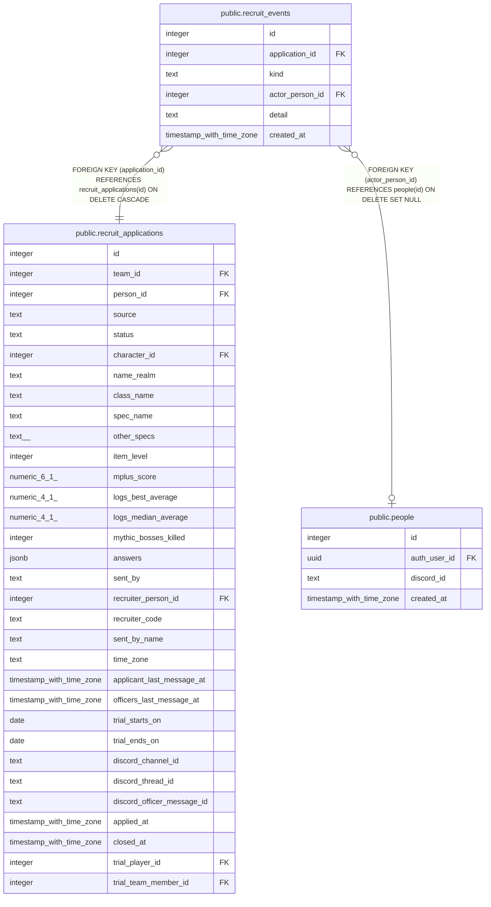

# public.recruit_events

## Description

A recruit record's history (#1539), for its What's happened list: who did what, when, and a short detail (a decline or extension reason, which reminder). The functions and the bot write it.

## Columns

| Name | Type | Default | Nullable | Children | Parents | Comment |
| ---- | ---- | ------- | -------- | -------- | ------- | ------- |
| id | integer |  | false |  |  |  |
| application_id | integer |  | false |  | [public.recruit_applications](public.recruit_applications.md) |  |
| kind | text |  | false |  |  |  |
| actor_person_id | integer |  | true |  | [public.people](public.people.md) |  |
| detail | text |  | true |  |  |  |
| created_at | timestamp with time zone | now() | false |  |  |  |

## Constraints

| Name | Type | Definition |
| ---- | ---- | ---------- |
| recruit_events_detail | CHECK | CHECK ((char_length(detail) <= 600)) |
| recruit_events_kind | CHECK | CHECK ((kind = ANY (ARRAY['applied'::text, 'added_by_officer'::text, 'withdrawn'::text, 'joined_discord'::text, 'ticket_opened'::text, 'officer_replied'::text, 'reminder_sent'::text, 'trial_started'::text, 'trial_extended'::text, 'declined'::text, 'joined'::text, 'not_joining'::text, 'closed'::text, 'reopened'::text, 'note_added'::text]))) |
| recruit_events_actor_person_id_fkey | FOREIGN KEY | FOREIGN KEY (actor_person_id) REFERENCES people(id) ON DELETE SET NULL |
| recruit_events_application_id_fkey | FOREIGN KEY | FOREIGN KEY (application_id) REFERENCES recruit_applications(id) ON DELETE CASCADE |
| recruit_events_pkey | PRIMARY KEY | PRIMARY KEY (id) |

## Indexes

| Name | Definition |
| ---- | ---------- |
| recruit_events_pkey | CREATE UNIQUE INDEX recruit_events_pkey ON public.recruit_events USING btree (id) |
| recruit_events_application | CREATE INDEX recruit_events_application ON public.recruit_events USING btree (application_id, created_at) |

## Relations

---

> Generated by [tbls](https://github.com/k1LoW/tbls)
