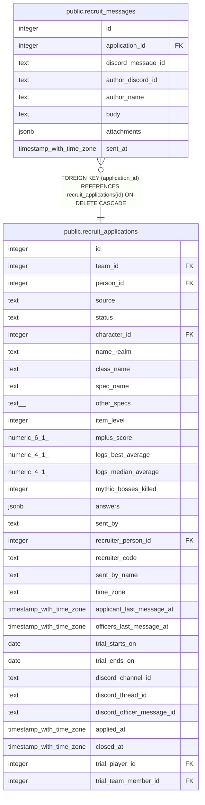

# public.recruit_messages

## Description

A closed ticket's conversation (#1539), saved by the bot before the channel is deleted. attachments is a list of {name, content_type}: the files themselves are not kept, since Discord's links expire.

## Columns

| Name | Type | Default | Nullable | Children | Parents | Comment |
| ---- | ---- | ------- | -------- | -------- | ------- | ------- |
| id | integer |  | false |  |  |  |
| application_id | integer |  | false |  | [public.recruit_applications](public.recruit_applications.md) |  |
| discord_message_id | text |  | false |  |  |  |
| author_discord_id | text |  | true |  |  |  |
| author_name | text |  | false |  |  |  |
| body | text | ''::text | false |  |  |  |
| attachments | jsonb | '[]'::jsonb | false |  |  |  |
| sent_at | timestamp with time zone |  | false |  |  |  |

## Constraints

| Name | Type | Definition |
| ---- | ---- | ---------- |
| recruit_messages_attachments | CHECK | CHECK ((jsonb_typeof(attachments) = 'array'::text)) |
| recruit_messages_author_discord_id | CHECK | CHECK ((author_discord_id ~ '^[0-9]{17,20}$'::text)) |
| recruit_messages_author_name | CHECK | CHECK ((char_length(author_name) <= 100)) |
| recruit_messages_body | CHECK | CHECK ((char_length(body) <= 4000)) |
| recruit_messages_discord_message_id | CHECK | CHECK ((discord_message_id ~ '^[0-9]{17,20}$'::text)) |
| recruit_messages_application_id_fkey | FOREIGN KEY | FOREIGN KEY (application_id) REFERENCES recruit_applications(id) ON DELETE CASCADE |
| recruit_messages_pkey | PRIMARY KEY | PRIMARY KEY (id) |
| recruit_messages_application_id_discord_message_id_key | UNIQUE | UNIQUE (application_id, discord_message_id) |

## Indexes

| Name | Definition |
| ---- | ---------- |
| recruit_messages_pkey | CREATE UNIQUE INDEX recruit_messages_pkey ON public.recruit_messages USING btree (id) |
| recruit_messages_application_id_discord_message_id_key | CREATE UNIQUE INDEX recruit_messages_application_id_discord_message_id_key ON public.recruit_messages USING btree (application_id, discord_message_id) |
| recruit_messages_application | CREATE INDEX recruit_messages_application ON public.recruit_messages USING btree (application_id, sent_at) |

## Relations

---

> Generated by [tbls](https://github.com/k1LoW/tbls)
