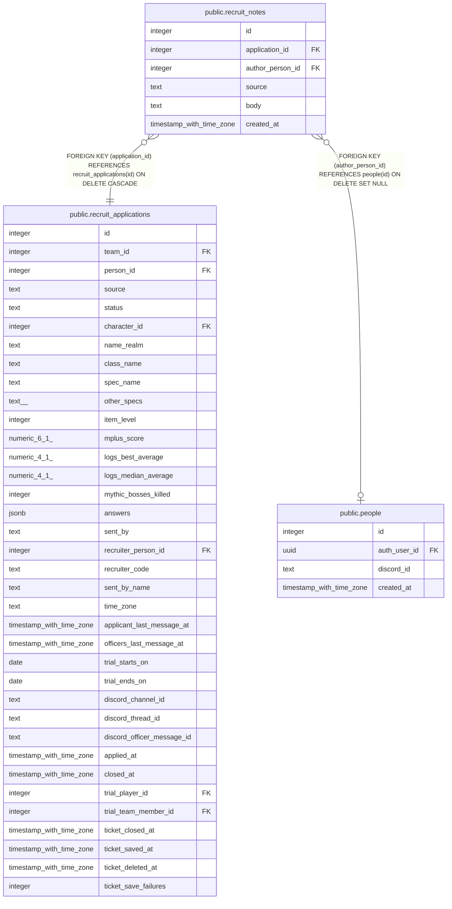

# public.recruit_notes

## Description

Notes on a recruit record (#1539), from Raid Hub (site) or a Discord button (discord). Never shown to the applicant; the recruiter who sent the person sees only their own.

## Columns

| Name | Type | Default | Nullable | Children | Parents | Comment |
| ---- | ---- | ------- | -------- | -------- | ------- | ------- |
| id | integer |  | false |  |  |  |
| application_id | integer |  | false |  | [public.recruit_applications](public.recruit_applications.md) |  |
| author_person_id | integer |  | true |  | [public.people](public.people.md) |  |
| source | text |  | false |  |  |  |
| body | text |  | false |  |  |  |
| created_at | timestamp with time zone | now() | false |  |  |  |

## Constraints

| Name | Type | Definition |
| ---- | ---- | ---------- |
| recruit_notes_body | CHECK | CHECK (((char_length(body) <= 2000) AND (body ~ '\S'::text))) |
| recruit_notes_source | CHECK | CHECK ((source = ANY (ARRAY['site'::text, 'discord'::text]))) |
| recruit_notes_author_person_id_fkey | FOREIGN KEY | FOREIGN KEY (author_person_id) REFERENCES people(id) ON DELETE SET NULL |
| recruit_notes_application_id_fkey | FOREIGN KEY | FOREIGN KEY (application_id) REFERENCES recruit_applications(id) ON DELETE CASCADE |
| recruit_notes_pkey | PRIMARY KEY | PRIMARY KEY (id) |

## Indexes

| Name | Definition |
| ---- | ---------- |
| recruit_notes_pkey | CREATE UNIQUE INDEX recruit_notes_pkey ON public.recruit_notes USING btree (id) |
| recruit_notes_application | CREATE INDEX recruit_notes_application ON public.recruit_notes USING btree (application_id, created_at) |

## Relations

---

> Generated by [tbls](https://github.com/k1LoW/tbls)
