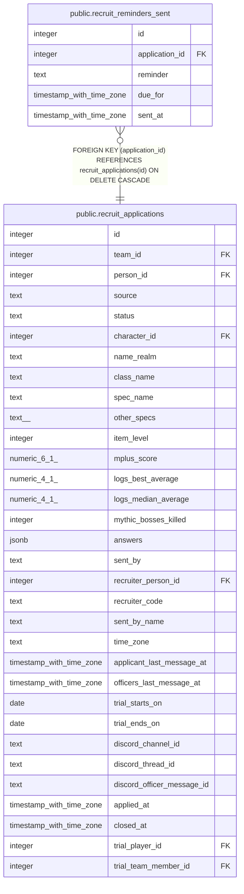

# public.recruit_reminders_sent

## Description

Which recruiting reminders the bot sent (#1539, #1543), the shape of raid_rsvp_reminders_sent. due_for is the message time or trial end the reminder was for, so a new message starts a new round and a repeat sweep sends nothing twice.

## Columns

| Name | Type | Default | Nullable | Children | Parents | Comment |
| ---- | ---- | ------- | -------- | -------- | ------- | ------- |
| id | integer |  | false |  |  |  |
| application_id | integer |  | false |  | [public.recruit_applications](public.recruit_applications.md) |  |
| reminder | text |  | false |  |  |  |
| due_for | timestamp with time zone |  | false |  |  |  |
| sent_at | timestamp with time zone | now() | false |  |  |  |

## Constraints

| Name | Type | Definition |
| ---- | ---- | ---------- |
| recruit_reminders_sent_reminder | CHECK | CHECK ((reminder ~ '^[a-z_]{1,40}$'::text)) |
| recruit_reminders_sent_application_id_fkey | FOREIGN KEY | FOREIGN KEY (application_id) REFERENCES recruit_applications(id) ON DELETE CASCADE |
| recruit_reminders_sent_pkey | PRIMARY KEY | PRIMARY KEY (id) |
| recruit_reminders_sent_application_id_reminder_due_for_key | UNIQUE | UNIQUE (application_id, reminder, due_for) |

## Indexes

| Name | Definition |
| ---- | ---------- |
| recruit_reminders_sent_pkey | CREATE UNIQUE INDEX recruit_reminders_sent_pkey ON public.recruit_reminders_sent USING btree (id) |
| recruit_reminders_sent_application_id_reminder_due_for_key | CREATE UNIQUE INDEX recruit_reminders_sent_application_id_reminder_due_for_key ON public.recruit_reminders_sent USING btree (application_id, reminder, due_for) |

## Relations

---

> Generated by [tbls](https://github.com/k1LoW/tbls)
