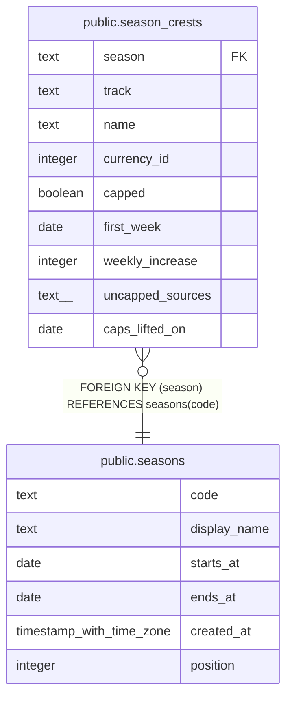

# public.season_crests

## Description

Each upgrade crest in a season (#1633). A capped crest's cap grows by weekly_increase every week from first_week (a reset Tuesday), so a missed week carries over; uncapped_sources never count toward it; from caps_lifted_on (Blizzard usually lifts every cap in the x.x.5 patch) it has none. Read through season_crest_cap(). Added by migration.

## Columns

| Name | Type | Default | Nullable | Children | Parents | Comment |
| ---- | ---- | ------- | -------- | -------- | ------- | ------- |
| season | text |  | false |  | [public.seasons](public.seasons.md) |  |
| track | text |  | false |  |  |  |
| name | text |  | false |  |  |  |
| currency_id | integer |  | true |  |  |  |
| capped | boolean |  | false |  |  |  |
| first_week | date |  | true |  |  |  |
| weekly_increase | integer |  | true |  |  |  |
| uncapped_sources | text[] | '{}'::text[] | false |  |  |  |
| caps_lifted_on | date |  | true |  |  |  |

## Constraints

| Name | Type | Definition |
| ---- | ---- | ---------- |
| season_crests_capped | CHECK | CHECK (((NOT capped) OR ((first_week IS NOT NULL) AND (weekly_increase IS NOT NULL)))) |
| season_crests_currency_id_check | CHECK | CHECK ((currency_id > 0)) |
| season_crests_name_check | CHECK | CHECK ((name ~ '\S'::text)) |
| season_crests_track_check | CHECK | CHECK ((track = ANY (ARRAY['Adventurer'::text, 'Veteran'::text, 'Champion'::text, 'Hero'::text, 'Myth'::text]))) |
| season_crests_weekly_increase_check | CHECK | CHECK ((weekly_increase > 0)) |
| season_crests_season_fkey | FOREIGN KEY | FOREIGN KEY (season) REFERENCES seasons(code) |
| season_crests_pkey | PRIMARY KEY | PRIMARY KEY (season, track) |

## Indexes

| Name | Definition |
| ---- | ---------- |
| season_crests_pkey | CREATE UNIQUE INDEX season_crests_pkey ON public.season_crests USING btree (season, track) |

## Relations

---

> Generated by [tbls](https://github.com/k1LoW/tbls)
