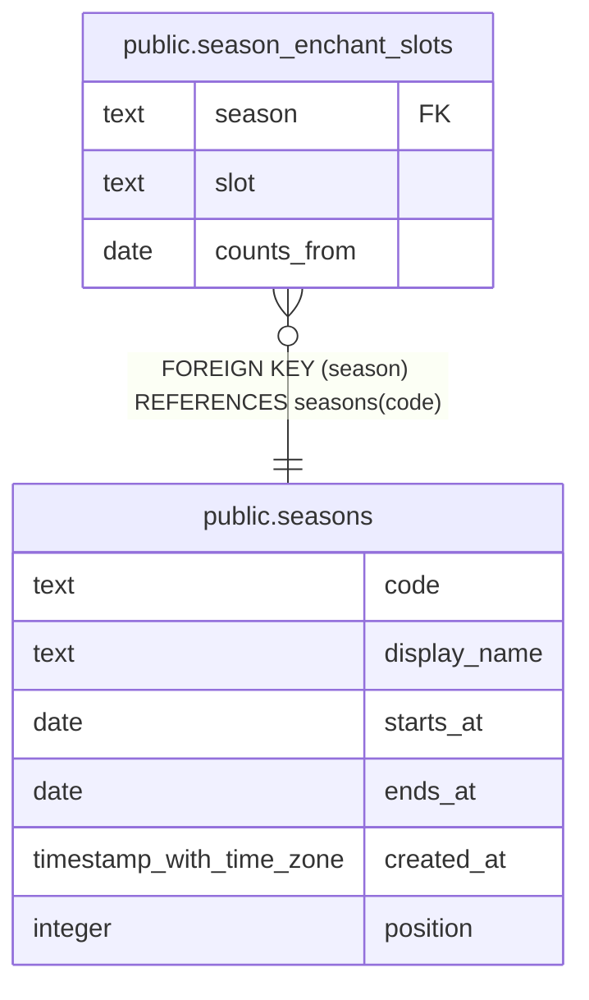

# public.season_enchant_slots

## Description

The slots that take an enchant in a season (#1633), in player_equipped_gear's slot names. counts_from: the day a slot added mid-season starts counting (null: the whole season). OFF_HAND counts only when the item is a weapon. Added by migration.

## Columns

| Name | Type | Default | Nullable | Children | Parents | Comment |
| ---- | ---- | ------- | -------- | -------- | ------- | ------- |
| season | text |  | false |  | [public.seasons](public.seasons.md) |  |
| slot | text |  | false |  |  |  |
| counts_from | date |  | true |  |  |  |

## Constraints

| Name | Type | Definition |
| ---- | ---- | ---------- |
| season_enchant_slots_slot_check | CHECK | CHECK ((slot = ANY (ARRAY['MAIN_HAND'::text, 'OFF_HAND'::text, 'HEAD'::text, 'NECK'::text, 'SHOULDER'::text, 'BACK'::text, 'CHEST'::text, 'WRIST'::text, 'HANDS'::text, 'WAIST'::text, 'LEGS'::text, 'FEET'::text, 'FINGER_1'::text, 'FINGER_2'::text]))) |
| season_enchant_slots_season_fkey | FOREIGN KEY | FOREIGN KEY (season) REFERENCES seasons(code) |
| season_enchant_slots_pkey | PRIMARY KEY | PRIMARY KEY (season, slot) |

## Indexes

| Name | Definition |
| ---- | ---------- |
| season_enchant_slots_pkey | CREATE UNIQUE INDEX season_enchant_slots_pkey ON public.season_enchant_slots USING btree (season, slot) |

## Relations

---

> Generated by [tbls](https://github.com/k1LoW/tbls)
