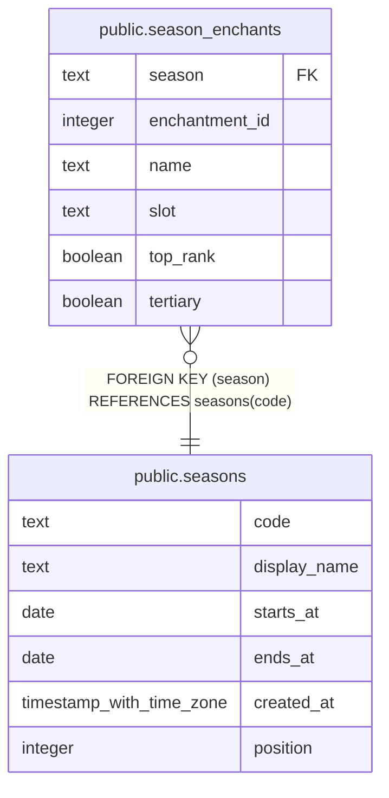

# public.season_enchants

## Description

The enchants that count in a season (#1633), by Blizzard's enchantment id. top_rank: the higher rank. tertiary: speed, leech or avoidance only, which the Lenient rule takes at any rank. An enchant not listed (an older expansion's) counts as none. Added by migration.

## Columns

| Name | Type | Default | Nullable | Children | Parents | Comment |
| ---- | ---- | ------- | -------- | -------- | ------- | ------- |
| season | text |  | false |  | [public.seasons](public.seasons.md) |  |
| enchantment_id | integer |  | false |  |  |  |
| name | text |  | false |  |  |  |
| slot | text |  | false |  |  |  |
| top_rank | boolean |  | false |  |  |  |
| tertiary | boolean |  | false |  |  |  |

## Constraints

| Name | Type | Definition |
| ---- | ---- | ---------- |
| season_enchants_enchantment_id_check | CHECK | CHECK ((enchantment_id > 0)) |
| season_enchants_name_check | CHECK | CHECK ((name ~ '\S'::text)) |
| season_enchants_slot_check | CHECK | CHECK ((slot = ANY (ARRAY['WEAPON'::text, 'HEAD'::text, 'SHOULDER'::text, 'CHEST'::text, 'LEGS'::text, 'FEET'::text, 'FINGER'::text]))) |
| season_enchants_season_fkey | FOREIGN KEY | FOREIGN KEY (season) REFERENCES seasons(code) |
| season_enchants_pkey | PRIMARY KEY | PRIMARY KEY (season, enchantment_id) |

## Indexes

| Name | Definition |
| ---- | ---------- |
| season_enchants_pkey | CREATE UNIQUE INDEX season_enchants_pkey ON public.season_enchants USING btree (season, enchantment_id) |

## Relations

---

> Generated by [tbls](https://github.com/k1LoW/tbls)
