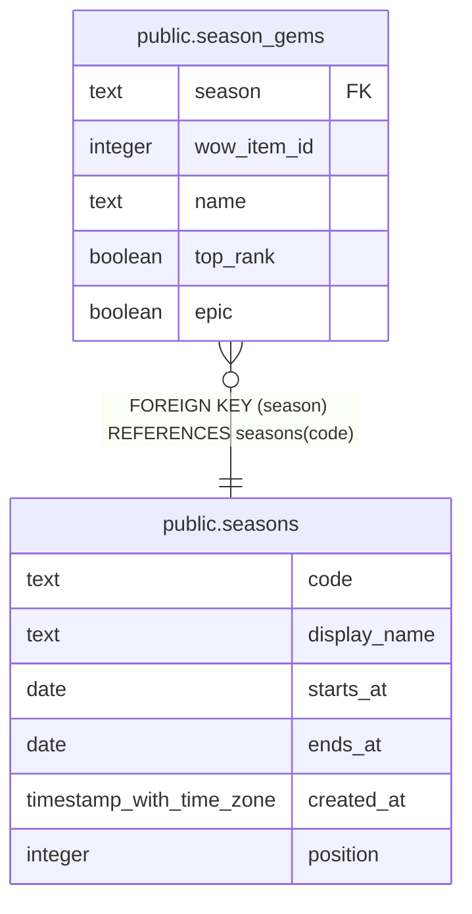

# public.season_gems

## Description

The gems that count in a season (#1633), by Blizzard's item id (wow_item_id, not items.id). top_rank: the best there is, the higher crafting rank of a Flawless gem or an epic gem (a gem with one rank is top). epic: an epic gem, which the audit checks for. A gem not listed counts as none. Added by migration.

## Columns

| Name | Type | Default | Nullable | Children | Parents | Comment |
| ---- | ---- | ------- | -------- | -------- | ------- | ------- |
| season | text |  | false |  | [public.seasons](public.seasons.md) |  |
| wow_item_id | integer |  | false |  |  |  |
| name | text |  | false |  |  |  |
| top_rank | boolean |  | false |  |  |  |
| epic | boolean |  | false |  |  |  |

## Constraints

| Name | Type | Definition |
| ---- | ---- | ---------- |
| season_gems_name_check | CHECK | CHECK ((name ~ '\S'::text)) |
| season_gems_wow_item_id_check | CHECK | CHECK ((wow_item_id > 0)) |
| season_gems_season_fkey | FOREIGN KEY | FOREIGN KEY (season) REFERENCES seasons(code) |
| season_gems_pkey | PRIMARY KEY | PRIMARY KEY (season, wow_item_id) |

## Indexes

| Name | Definition |
| ---- | ---------- |
| season_gems_pkey | CREATE UNIQUE INDEX season_gems_pkey ON public.season_gems USING btree (season, wow_item_id) |

## Relations

---

> Generated by [tbls](https://github.com/k1LoW/tbls)
