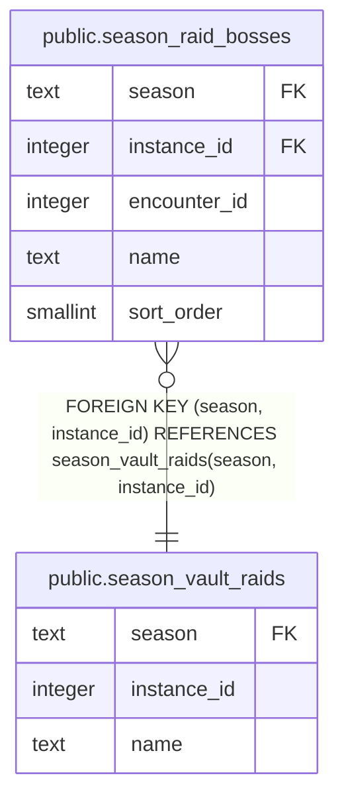

# public.season_raid_bosses

## Description

The bosses of each season's counted raids (#1641), by Blizzard journal encounter id, in the game's order. Added by migration per season.

## Columns

| Name | Type | Default | Nullable | Children | Parents | Comment |
| ---- | ---- | ------- | -------- | -------- | ------- | ------- |
| season | text |  | false |  | [public.season_vault_raids](public.season_vault_raids.md) |  |
| instance_id | integer |  | false |  | [public.season_vault_raids](public.season_vault_raids.md) |  |
| encounter_id | integer |  | false |  |  |  |
| name | text |  | false |  |  |  |
| sort_order | smallint |  | false |  |  |  |

## Constraints

| Name | Type | Definition |
| ---- | ---- | ---------- |
| season_raid_bosses_encounter_id_check | CHECK | CHECK ((encounter_id > 0)) |
| season_raid_bosses_instance_id_check | CHECK | CHECK ((instance_id > 0)) |
| season_raid_bosses_name_check | CHECK | CHECK ((name ~ '\S'::text)) |
| season_raid_bosses_sort_order_check | CHECK | CHECK ((sort_order > 0)) |
| season_raid_bosses_season_instance_id_fkey | FOREIGN KEY | FOREIGN KEY (season, instance_id) REFERENCES season_vault_raids(season, instance_id) |
| season_raid_bosses_pkey | PRIMARY KEY | PRIMARY KEY (season, encounter_id) |
| season_raid_bosses_order | UNIQUE | UNIQUE (season, sort_order) |

## Indexes

| Name | Definition |
| ---- | ---------- |
| season_raid_bosses_pkey | CREATE UNIQUE INDEX season_raid_bosses_pkey ON public.season_raid_bosses USING btree (season, encounter_id) |
| season_raid_bosses_order | CREATE UNIQUE INDEX season_raid_bosses_order ON public.season_raid_bosses USING btree (season, sort_order) |

## Relations

---

> Generated by [tbls](https://github.com/k1LoW/tbls)
