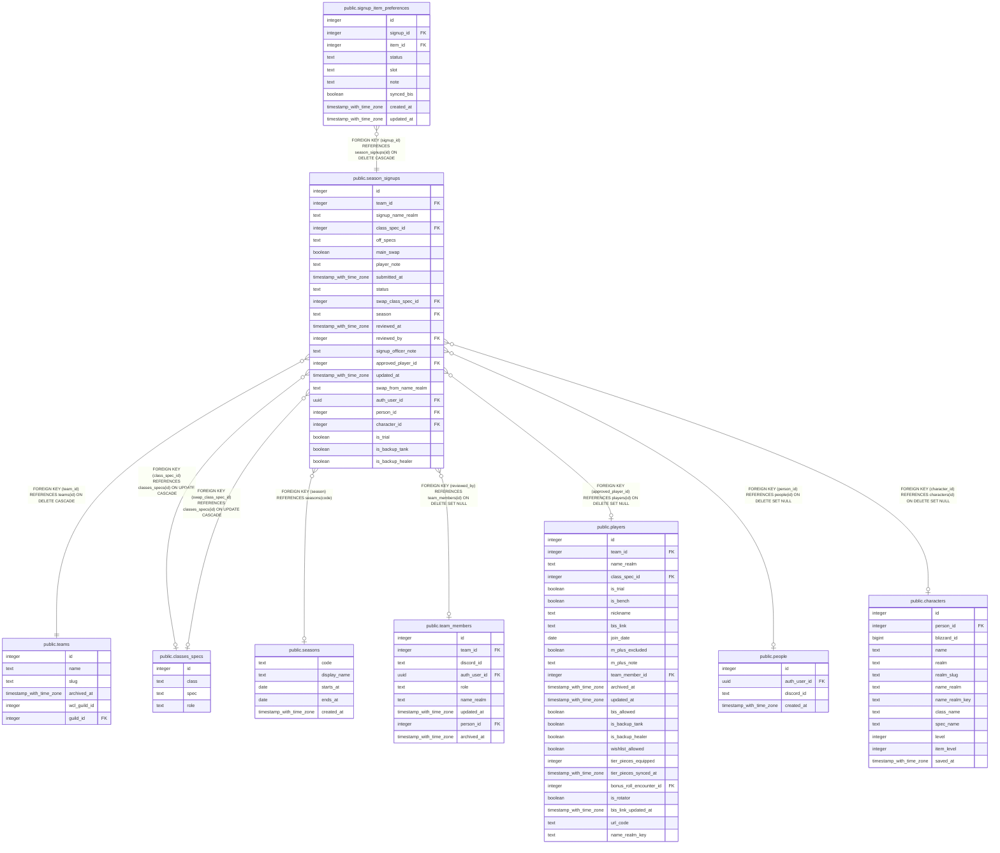

# public.season_signups

## Columns

| Name | Type | Default | Nullable | Children | Parents | Comment |
| ---- | ---- | ------- | -------- | -------- | ------- | ------- |
| id | integer | nextval('signups_id_seq'::regclass) | false | [public.signup_item_preferences](public.signup_item_preferences.md) |  |  |
| team_id | integer |  | false |  | [public.teams](public.teams.md) |  |
| signup_name_realm | text |  | false |  |  |  |
| class_spec_id | integer |  | true |  | [public.classes_specs](public.classes_specs.md) |  |
| off_specs | text |  | true |  |  |  |
| main_swap | boolean | false | false |  |  |  |
| player_note | text |  | true |  |  |  |
| submitted_at | timestamp with time zone | now() | false |  |  |  |
| status | text | 'pending'::text | false |  |  |  |
| swap_class_spec_id | integer |  | true |  | [public.classes_specs](public.classes_specs.md) |  |
| season | text |  | true |  | [public.seasons](public.seasons.md) |  |
| reviewed_at | timestamp with time zone |  | true |  |  |  |
| reviewed_by | integer |  | true |  | [public.team_members](public.team_members.md) |  |
| signup_officer_note | text |  | true |  |  |  |
| approved_player_id | integer |  | true |  | [public.players](public.players.md) |  |
| updated_at | timestamp with time zone |  | true |  |  |  |
| swap_from_name_realm | text |  | true |  |  |  |
| auth_user_id | uuid |  | true |  |  |  |
| person_id | integer |  | true |  | [public.people](public.people.md) | The person who signed up (#1465). Set by declare_season_signup(); null on rows submit_season_signup() wrote, which carry auth_user_id instead. |
| character_id | integer |  | true |  | [public.characters](public.characters.md) | The saved character the signer picked (#1465). Emptied if that character row goes, for example when the person chooses alts again (#1430); signup_name_realm stays the name of record. |
| is_trial | boolean |  | true |  |  | The officer's Trial flag from the Projected Roster (#1342), applied when signups close (#1467). Null until an officer sets it. |
| is_backup_tank | boolean | false | false |  |  | Backup tank: the raider's answer on their signup (#1622) or the officer's box on the Projected Roster (#1342), whichever came last; applied when signups close (#1467). |
| is_backup_healer | boolean | false | false |  |  | Backup healer: the raider's answer on their signup (#1622) or the officer's box on the Projected Roster (#1342), whichever came last; applied when signups close (#1467). |

## Constraints

| Name | Type | Definition |
| ---- | ---- | ---------- |
| season_signups_player_only_when_added | CHECK | CHECK (((approved_player_id IS NULL) OR (status = 'added'::text))) |
| season_signups_status_check | CHECK | CHECK ((status = ANY (ARRAY['pending'::text, 'approved'::text, 'rejected'::text, 'added'::text]))) |
| season_signups_auth_user_id_fkey | FOREIGN KEY | FOREIGN KEY (auth_user_id) REFERENCES auth.users(id) ON DELETE SET NULL |
| season_signups_swap_class_spec_id_fkey | FOREIGN KEY | FOREIGN KEY (swap_class_spec_id) REFERENCES classes_specs(id) ON UPDATE CASCADE |
| signups_class_spec_id_fkey | FOREIGN KEY | FOREIGN KEY (class_spec_id) REFERENCES classes_specs(id) ON UPDATE CASCADE |
| season_signups_approved_player_id_fkey | FOREIGN KEY | FOREIGN KEY (approved_player_id) REFERENCES players(id) ON DELETE SET NULL |
| signups_pkey | PRIMARY KEY | PRIMARY KEY (id) |
| season_signups_reviewed_by_fkey | FOREIGN KEY | FOREIGN KEY (reviewed_by) REFERENCES team_members(id) ON DELETE SET NULL |
| signups_team_id_fkey | FOREIGN KEY | FOREIGN KEY (team_id) REFERENCES teams(id) ON DELETE CASCADE |
| season_signups_person_id_fkey | FOREIGN KEY | FOREIGN KEY (person_id) REFERENCES people(id) ON DELETE SET NULL |
| season_signups_season_fkey | FOREIGN KEY | FOREIGN KEY (season) REFERENCES seasons(code) |
| season_signups_character_id_fkey | FOREIGN KEY | FOREIGN KEY (character_id) REFERENCES characters(id) ON DELETE SET NULL |

## Indexes

| Name | Definition |
| ---- | ---------- |
| signups_pkey | CREATE UNIQUE INDEX signups_pkey ON public.season_signups USING btree (id) |
| season_signups_one_per_person | CREATE UNIQUE INDEX season_signups_one_per_person ON public.season_signups USING btree (person_id, team_id, season) WHERE (status <> 'rejected'::text) |

## Triggers

| Name | Definition |
| ---- | ---------- |
| trg_season_signups_updated_at | CREATE TRIGGER trg_season_signups_updated_at BEFORE UPDATE ON public.season_signups FOR EACH ROW EXECUTE FUNCTION set_updated_at() |
| season_signups_carry_wishlist | CREATE TRIGGER season_signups_carry_wishlist AFTER UPDATE OF status, signup_name_realm, approved_player_id ON public.season_signups FOR EACH ROW WHEN (((new.status IS DISTINCT FROM old.status) OR (new.signup_name_realm IS DISTINCT FROM old.signup_name_realm) OR (new.approved_player_id IS DISTINCT FROM old.approved_player_id))) EXECUTE FUNCTION carry_signup_wishlist() |

## Relations

---

> Generated by [tbls](https://github.com/k1LoW/tbls)
