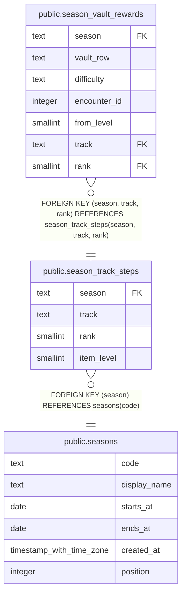

# public.season_track_steps

## Description

Each upgrade step's item level in a season (#1637), e.g. MID2 Hero 4 = 315. Myth 9 is the special step the last Mythic bosses drop. Added by migration.

## Columns

| Name | Type | Default | Nullable | Children | Parents | Comment |
| ---- | ---- | ------- | -------- | -------- | ------- | ------- |
| season | text |  | false | [public.season_vault_rewards](public.season_vault_rewards.md) | [public.seasons](public.seasons.md) |  |
| track | text |  | false | [public.season_vault_rewards](public.season_vault_rewards.md) |  |  |
| rank | smallint |  | false | [public.season_vault_rewards](public.season_vault_rewards.md) |  |  |
| item_level | smallint |  | false |  |  |  |

## Constraints

| Name | Type | Definition |
| ---- | ---- | ---------- |
| season_track_steps_item_level_check | CHECK | CHECK ((item_level > 0)) |
| season_track_steps_rank_check | CHECK | CHECK ((rank > 0)) |
| season_track_steps_track_check | CHECK | CHECK ((track = ANY (ARRAY['Adventurer'::text, 'Veteran'::text, 'Champion'::text, 'Hero'::text, 'Myth'::text]))) |
| season_track_steps_season_fkey | FOREIGN KEY | FOREIGN KEY (season) REFERENCES seasons(code) |
| season_track_steps_pkey | PRIMARY KEY | PRIMARY KEY (season, track, rank) |

## Indexes

| Name | Definition |
| ---- | ---------- |
| season_track_steps_pkey | CREATE UNIQUE INDEX season_track_steps_pkey ON public.season_track_steps USING btree (season, track, rank) |

## Relations

---

> Generated by [tbls](https://github.com/k1LoW/tbls)
