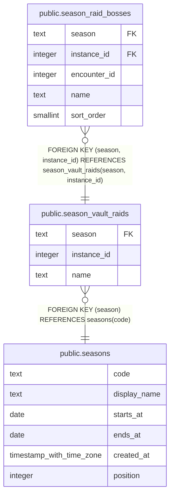

# public.season_vault_raids

## Description

The raids whose kills fill Raid vault slots in a season (#1637), by Blizzard journal instance id. Added by migration.

## Columns

| Name | Type | Default | Nullable | Children | Parents | Comment |
| ---- | ---- | ------- | -------- | -------- | ------- | ------- |
| season | text |  | false | [public.season_raid_bosses](public.season_raid_bosses.md) | [public.seasons](public.seasons.md) |  |
| instance_id | integer |  | false | [public.season_raid_bosses](public.season_raid_bosses.md) |  |  |
| name | text |  | false |  |  |  |

## Constraints

| Name | Type | Definition |
| ---- | ---- | ---------- |
| season_vault_raids_instance_id_check | CHECK | CHECK ((instance_id > 0)) |
| season_vault_raids_name_check | CHECK | CHECK ((name ~ '\S'::text)) |
| season_vault_raids_season_fkey | FOREIGN KEY | FOREIGN KEY (season) REFERENCES seasons(code) |
| season_vault_raids_pkey | PRIMARY KEY | PRIMARY KEY (season, instance_id) |

## Indexes

| Name | Definition |
| ---- | ---------- |
| season_vault_raids_pkey | CREATE UNIQUE INDEX season_vault_raids_pkey ON public.season_vault_raids USING btree (season, instance_id) |

## Relations

---

> Generated by [tbls](https://github.com/k1LoW/tbls)
