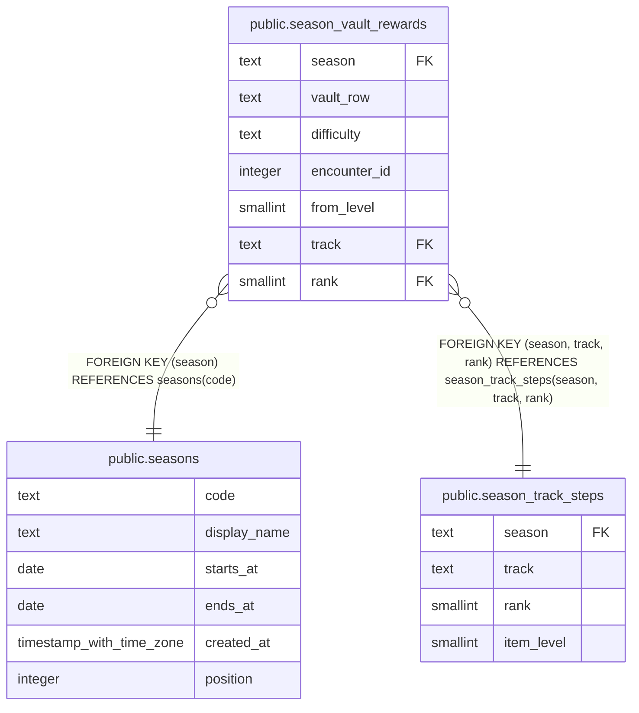

# public.season_vault_rewards

## Description

What a run offers in the Great Vault in a season (#1637). Raid: by kill difficulty, and encounter_id (Blizzard journal id) for a boss with its own reward. Dungeon: a key from from_level up. World: a delve from tier from_level up. Added by migration.

## Columns

| Name | Type | Default | Nullable | Children | Parents | Comment |
| ---- | ---- | ------- | -------- | -------- | ------- | ------- |
| season | text |  | false |  | [public.seasons](public.seasons.md) [public.season_track_steps](public.season_track_steps.md) |  |
| vault_row | text |  | false |  |  |  |
| difficulty | text |  | true |  |  |  |
| encounter_id | integer |  | true |  |  |  |
| from_level | smallint |  | true |  |  |  |
| track | text |  | false |  | [public.season_track_steps](public.season_track_steps.md) |  |
| rank | smallint |  | false |  | [public.season_track_steps](public.season_track_steps.md) |  |

## Constraints

| Name | Type | Definition |
| ---- | ---- | ---------- |
| season_vault_rewards_difficulty_check | CHECK | CHECK ((difficulty = ANY (ARRAY['lfr'::text, 'normal'::text, 'heroic'::text, 'mythic'::text]))) |
| season_vault_rewards_encounter_id_check | CHECK | CHECK ((encounter_id > 0)) |
| season_vault_rewards_from_level_check | CHECK | CHECK ((from_level > 0)) |
| season_vault_rewards_key | CHECK | CHECK ( CASE vault_row     WHEN 'raid'::text THEN ((difficulty IS NOT NULL) AND (from_level IS NULL))     ELSE ((difficulty IS NULL) AND (encounter_id IS NULL) AND (from_level IS NOT NULL)) END) |
| season_vault_rewards_vault_row_check | CHECK | CHECK ((vault_row = ANY (ARRAY['raid'::text, 'dungeon'::text, 'world'::text]))) |
| season_vault_rewards_season_fkey | FOREIGN KEY | FOREIGN KEY (season) REFERENCES seasons(code) |
| season_vault_rewards_season_track_rank_fkey | FOREIGN KEY | FOREIGN KEY (season, track, rank) REFERENCES season_track_steps(season, track, rank) |
| season_vault_rewards_unique | UNIQUE | UNIQUE NULLS NOT DISTINCT (season, vault_row, difficulty, encounter_id, from_level) |

## Indexes

| Name | Definition |
| ---- | ---------- |
| season_vault_rewards_unique | CREATE UNIQUE INDEX season_vault_rewards_unique ON public.season_vault_rewards USING btree (season, vault_row, difficulty, encounter_id, from_level) NULLS NOT DISTINCT |

## Relations

---

> Generated by [tbls](https://github.com/k1LoW/tbls)
