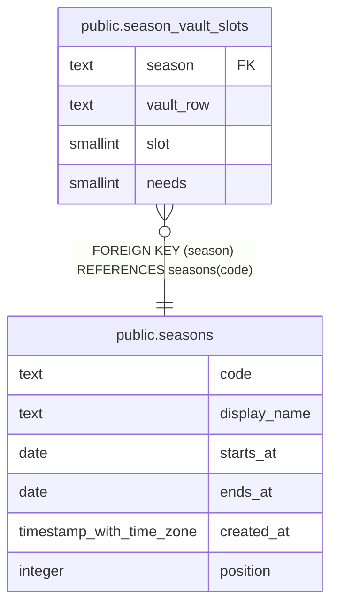

# public.season_vault_slots

## Description

How many runs fill each Great Vault slot in a season (#1637): raid bosses, keys, or delves. Added by migration.

## Columns

| Name | Type | Default | Nullable | Children | Parents | Comment |
| ---- | ---- | ------- | -------- | -------- | ------- | ------- |
| season | text |  | false |  | [public.seasons](public.seasons.md) |  |
| vault_row | text |  | false |  |  |  |
| slot | smallint |  | false |  |  |  |
| needs | smallint |  | false |  |  |  |

## Constraints

| Name | Type | Definition |
| ---- | ---- | ---------- |
| season_vault_slots_needs_check | CHECK | CHECK ((needs > 0)) |
| season_vault_slots_slot_check | CHECK | CHECK (((slot >= 1) AND (slot <= 3))) |
| season_vault_slots_vault_row_check | CHECK | CHECK ((vault_row = ANY (ARRAY['raid'::text, 'dungeon'::text, 'world'::text]))) |
| season_vault_slots_season_fkey | FOREIGN KEY | FOREIGN KEY (season) REFERENCES seasons(code) |
| season_vault_slots_pkey | PRIMARY KEY | PRIMARY KEY (season, vault_row, slot) |

## Indexes

| Name | Definition |
| ---- | ---------- |
| season_vault_slots_pkey | CREATE UNIQUE INDEX season_vault_slots_pkey ON public.season_vault_slots USING btree (season, vault_row, slot) |

## Relations

---

> Generated by [tbls](https://github.com/k1LoW/tbls)
