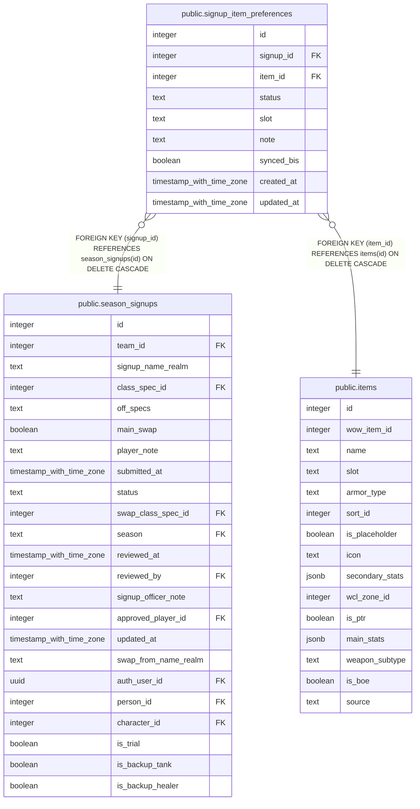

# public.signup_item_preferences

## Columns

| Name | Type | Default | Nullable | Children | Parents | Comment |
| ---- | ---- | ------- | -------- | -------- | ------- | ------- |
| id | integer |  | false |  |  |  |
| signup_id | integer |  | false |  | [public.season_signups](public.season_signups.md) |  |
| item_id | integer |  | false |  | [public.items](public.items.md) |  |
| status | text |  | false |  |  |  |
| slot | text |  | true |  |  |  |
| note | text |  | true |  |  |  |
| synced_bis | boolean | false | false |  |  |  |
| created_at | timestamp with time zone | now() | false |  |  |  |
| updated_at | timestamp with time zone |  | true |  |  |  |

## Constraints

| Name | Type | Definition |
| ---- | ---- | ---------- |
| signup_item_preferences_status_check | CHECK | CHECK ((status = ANY (ARRAY['bis'::text, 'good'::text, 'ok'::text, 'catalyst'::text, 'pass'::text]))) |
| signup_item_preferences_item_id_fkey | FOREIGN KEY | FOREIGN KEY (item_id) REFERENCES items(id) ON DELETE CASCADE |
| signup_item_preferences_signup_id_fkey | FOREIGN KEY | FOREIGN KEY (signup_id) REFERENCES season_signups(id) ON DELETE CASCADE |
| signup_item_preferences_pkey | PRIMARY KEY | PRIMARY KEY (id) |

## Indexes

| Name | Definition |
| ---- | ---------- |
| signup_item_preferences_pkey | CREATE UNIQUE INDEX signup_item_preferences_pkey ON public.signup_item_preferences USING btree (id) |
| signup_item_preferences_no_dupe_item_key | CREATE UNIQUE INDEX signup_item_preferences_no_dupe_item_key ON public.signup_item_preferences USING btree (signup_id, item_id, COALESCE(slot, ''::text)) |

## Triggers

| Name | Definition |
| ---- | ---------- |
| trg_signup_item_preferences_updated_at | CREATE TRIGGER trg_signup_item_preferences_updated_at BEFORE UPDATE ON public.signup_item_preferences FOR EACH ROW EXECUTE FUNCTION set_updated_at() |
| trg_signup_item_preferences_wishlist_open | CREATE TRIGGER trg_signup_item_preferences_wishlist_open BEFORE INSERT OR DELETE OR UPDATE ON public.signup_item_preferences FOR EACH ROW EXECUTE FUNCTION restrict_signup_item_preferences_to_open_wishlist() |

## Relations

---

> Generated by [tbls](https://github.com/k1LoW/tbls)
