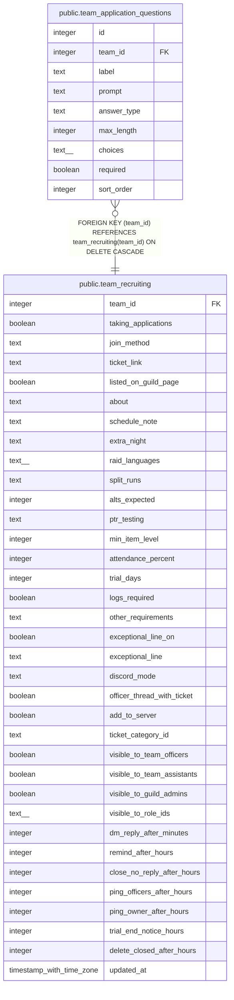

# public.team_application_questions

## Description

A team's own application questions (#1536), in sort_order after the starter questions. Up to 20. short_text takes a max_length up to 200, paragraph up to 4,000; choice takes 2 to 10 choices. Saved through save_team_application_questions(), which keeps each question's id.

## Columns

| Name | Type | Default | Nullable | Children | Parents | Comment |
| ---- | ---- | ------- | -------- | -------- | ------- | ------- |
| id | integer |  | false |  |  |  |
| team_id | integer |  | false |  | [public.team_recruiting](public.team_recruiting.md) |  |
| label | text |  | false |  |  |  |
| prompt | text |  | false |  |  |  |
| answer_type | text |  | false |  |  |  |
| max_length | integer |  | true |  |  |  |
| choices | text[] | '{}'::text[] | false |  |  |  |
| required | boolean | false | false |  |  |  |
| sort_order | integer |  | false |  |  |  |

## Constraints

| Name | Type | Definition |
| ---- | ---- | ---------- |
| team_application_questions_answer_type | CHECK | CHECK ((answer_type = ANY (ARRAY['short_text'::text, 'paragraph'::text, 'link'::text, 'choice'::text, 'yes_no'::text, 'picture'::text]))) |
| team_application_questions_choices | CHECK | CHECK ( CASE     WHEN (answer_type = 'choice'::text) THEN (((cardinality(choices) >= 2) AND (cardinality(choices) <= 10)) AND text_items_match(choices, '^(?=.*\S)[^\r\n]{1,100}$'::text))     ELSE (cardinality(choices) = 0) END) |
| team_application_questions_label | CHECK | CHECK (((char_length(label) <= 40) AND (label ~ '\S'::text) AND (label !~ '[\r\n]'::text))) |
| team_application_questions_max_length | CHECK | CHECK ( CASE answer_type     WHEN 'short_text'::text THEN COALESCE(((max_length >= 1) AND (max_length <= 200)), false)     WHEN 'paragraph'::text THEN COALESCE(((max_length >= 1) AND (max_length <= 4000)), false)     ELSE (max_length IS NULL) END) |
| team_application_questions_prompt | CHECK | CHECK (((char_length(prompt) <= 300) AND (prompt ~ '\S'::text) AND (prompt !~ '[\r\n]'::text))) |
| team_application_questions_team_id_fkey | FOREIGN KEY | FOREIGN KEY (team_id) REFERENCES team_recruiting(team_id) ON DELETE CASCADE |
| team_application_questions_pkey | PRIMARY KEY | PRIMARY KEY (id) |

## Indexes

| Name | Definition |
| ---- | ---------- |
| team_application_questions_pkey | CREATE UNIQUE INDEX team_application_questions_pkey ON public.team_application_questions USING btree (id) |
| team_application_questions_team | CREATE INDEX team_application_questions_team ON public.team_application_questions USING btree (team_id, sort_order) |

## Relations

---

> Generated by [tbls](https://github.com/k1LoW/tbls)
