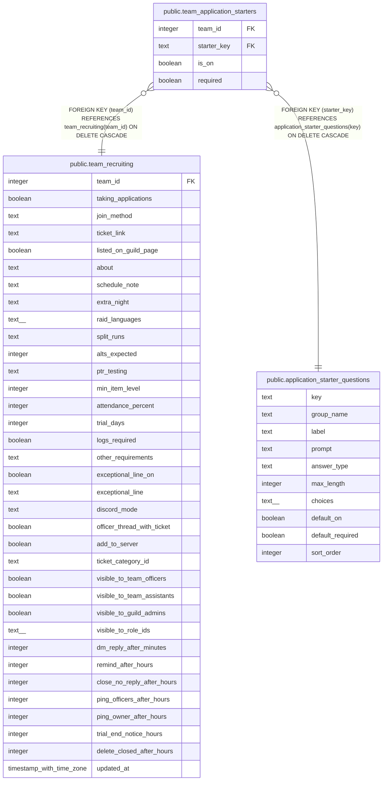

# public.team_application_starters

## Description

What a team changed about a starter question (#1536): a row only where is_on or required differs from the starter's default. No row: the default. Saved through save_team_application_questions().

## Columns

| Name | Type | Default | Nullable | Children | Parents | Comment |
| ---- | ---- | ------- | -------- | -------- | ------- | ------- |
| team_id | integer |  | false |  | [public.team_recruiting](public.team_recruiting.md) |  |
| starter_key | text |  | false |  | [public.application_starter_questions](public.application_starter_questions.md) |  |
| is_on | boolean |  | false |  |  |  |
| required | boolean |  | false |  |  |  |

## Constraints

| Name | Type | Definition |
| ---- | ---- | ---------- |
| team_application_starters_required_on | CHECK | CHECK ((is_on OR (NOT required))) |
| team_application_starters_team_id_fkey | FOREIGN KEY | FOREIGN KEY (team_id) REFERENCES team_recruiting(team_id) ON DELETE CASCADE |
| team_application_starters_starter_key_fkey | FOREIGN KEY | FOREIGN KEY (starter_key) REFERENCES application_starter_questions(key) ON DELETE CASCADE |
| team_application_starters_pkey | PRIMARY KEY | PRIMARY KEY (team_id, starter_key) |

## Indexes

| Name | Definition |
| ---- | ---------- |
| team_application_starters_pkey | CREATE UNIQUE INDEX team_application_starters_pkey ON public.team_application_starters USING btree (team_id, starter_key) |

## Relations

---

> Generated by [tbls](https://github.com/k1LoW/tbls)
