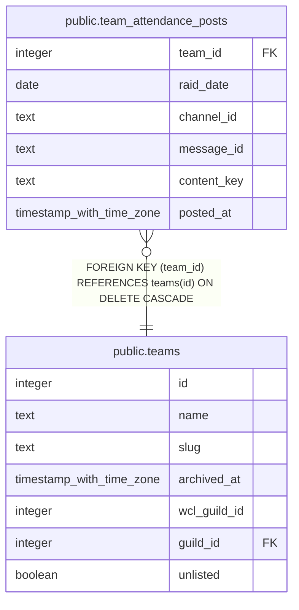

# public.team_attendance_posts

## Description

The officer-channel message wcl-sync's hourly run posted for each team and raid night with attendance items (#1847). content_key is what the message lists ('all set' once every item has a status). Written by wcl-sync with the service role; later runs edit this message as items are set.

## Columns

| Name | Type | Default | Nullable | Children | Parents | Comment |
| ---- | ---- | ------- | -------- | -------- | ------- | ------- |
| team_id | integer |  | false |  | [public.teams](public.teams.md) |  |
| raid_date | date |  | false |  |  |  |
| channel_id | text |  | false |  |  |  |
| message_id | text |  | false |  |  |  |
| content_key | text |  | false |  |  |  |
| posted_at | timestamp with time zone | now() | false |  |  |  |

## Constraints

| Name | Type | Definition |
| ---- | ---- | ---------- |
| team_attendance_posts_team_id_fkey | FOREIGN KEY | FOREIGN KEY (team_id) REFERENCES teams(id) ON DELETE CASCADE |
| team_attendance_posts_pkey | PRIMARY KEY | PRIMARY KEY (team_id, raid_date) |

## Indexes

| Name | Definition |
| ---- | ---------- |
| team_attendance_posts_pkey | CREATE UNIQUE INDEX team_attendance_posts_pkey ON public.team_attendance_posts USING btree (team_id, raid_date) |

## Relations

---

> Generated by [tbls](https://github.com/k1LoW/tbls)
