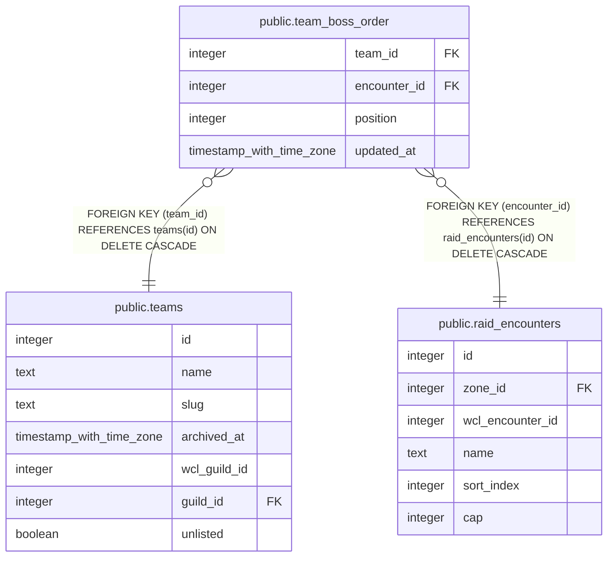

# public.team_boss_order

## Description

The order a team pulls its bosses in (#1679), saved from Boss Lineup with "every night after". New raid nights fill in this order; a boss with no row fills after, in the game's order. Written and read only by the lineup functions.

## Columns

| Name | Type | Default | Nullable | Children | Parents | Comment |
| ---- | ---- | ------- | -------- | -------- | ------- | ------- |
| team_id | integer |  | false |  | [public.teams](public.teams.md) |  |
| encounter_id | integer |  | false |  | [public.raid_encounters](public.raid_encounters.md) |  |
| position | integer |  | false |  |  |  |
| updated_at | timestamp with time zone | now() | false |  |  |  |

## Constraints

| Name | Type | Definition |
| ---- | ---- | ---------- |
| team_boss_order_position_check | CHECK | CHECK (("position" > 0)) |
| team_boss_order_team_id_fkey | FOREIGN KEY | FOREIGN KEY (team_id) REFERENCES teams(id) ON DELETE CASCADE |
| team_boss_order_encounter_id_fkey | FOREIGN KEY | FOREIGN KEY (encounter_id) REFERENCES raid_encounters(id) ON DELETE CASCADE |
| team_boss_order_pkey | PRIMARY KEY | PRIMARY KEY (team_id, encounter_id) |

## Indexes

| Name | Definition |
| ---- | ---------- |
| team_boss_order_pkey | CREATE UNIQUE INDEX team_boss_order_pkey ON public.team_boss_order USING btree (team_id, encounter_id) |
| team_boss_order_encounter_id_idx | CREATE INDEX team_boss_order_encounter_id_idx ON public.team_boss_order USING btree (encounter_id) |

## Relations

---

> Generated by [tbls](https://github.com/k1LoW/tbls)
