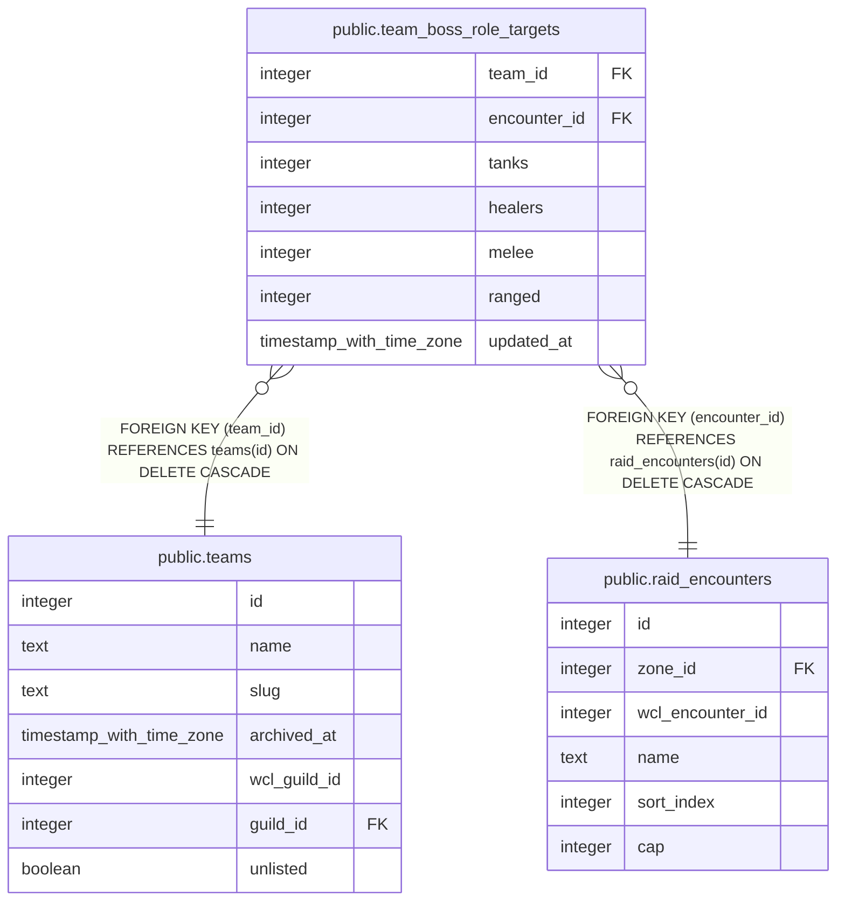

# public.team_boss_role_targets

## Description

What one boss needs for a team (#1682): tanks, healers, melee and ranged counts for the boss lineup's checks. A null tanks or healers uses the team's target (team_lineup_settings); a null melee or ranged means no target. A boss with no row uses the team's targets. Written only by set_boss_role_targets().

## Columns

| Name | Type | Default | Nullable | Children | Parents | Comment |
| ---- | ---- | ------- | -------- | -------- | ------- | ------- |
| team_id | integer |  | false |  | [public.teams](public.teams.md) |  |
| encounter_id | integer |  | false |  | [public.raid_encounters](public.raid_encounters.md) |  |
| tanks | integer |  | true |  |  |  |
| healers | integer |  | true |  |  |  |
| melee | integer |  | true |  |  |  |
| ranged | integer |  | true |  |  |  |
| updated_at | timestamp with time zone | now() | false |  |  |  |

## Constraints

| Name | Type | Definition |
| ---- | ---- | ---------- |
| team_boss_role_targets_check | CHECK | CHECK ((num_nonnulls(tanks, healers, melee, ranged) > 0)) |
| team_boss_role_targets_healers_check | CHECK | CHECK (((healers >= 0) AND (healers <= 30))) |
| team_boss_role_targets_melee_check | CHECK | CHECK (((melee >= 0) AND (melee <= 30))) |
| team_boss_role_targets_ranged_check | CHECK | CHECK (((ranged >= 0) AND (ranged <= 30))) |
| team_boss_role_targets_tanks_check | CHECK | CHECK (((tanks >= 0) AND (tanks <= 30))) |
| team_boss_role_targets_team_id_fkey | FOREIGN KEY | FOREIGN KEY (team_id) REFERENCES teams(id) ON DELETE CASCADE |
| team_boss_role_targets_encounter_id_fkey | FOREIGN KEY | FOREIGN KEY (encounter_id) REFERENCES raid_encounters(id) ON DELETE CASCADE |
| team_boss_role_targets_pkey | PRIMARY KEY | PRIMARY KEY (team_id, encounter_id) |

## Indexes

| Name | Definition |
| ---- | ---------- |
| team_boss_role_targets_pkey | CREATE UNIQUE INDEX team_boss_role_targets_pkey ON public.team_boss_role_targets USING btree (team_id, encounter_id) |
| team_boss_role_targets_encounter_id_idx | CREATE INDEX team_boss_role_targets_encounter_id_idx ON public.team_boss_role_targets USING btree (encounter_id) |

## Relations

---

> Generated by [tbls](https://github.com/k1LoW/tbls)
