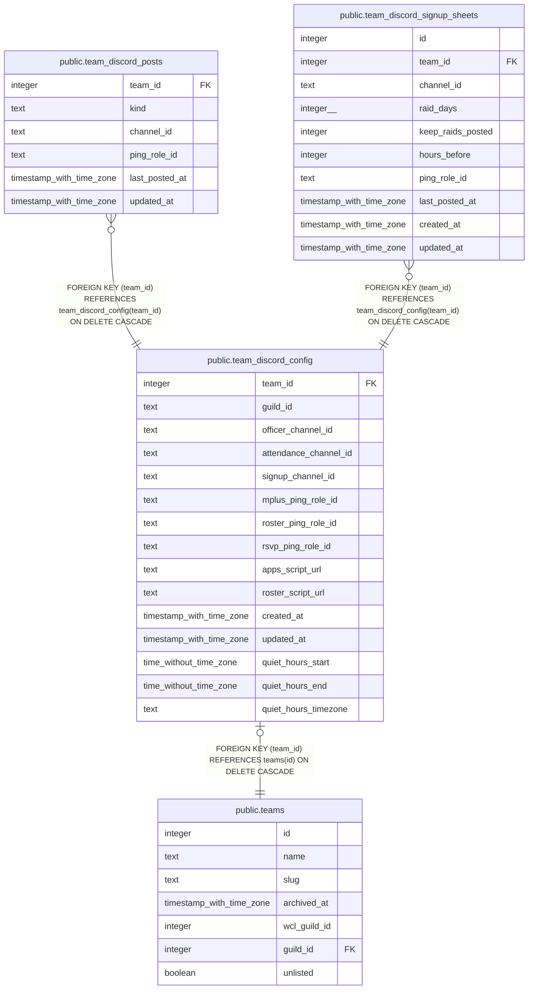

# public.team_discord_config

## Description

A team's Discord server, quiet hours and the old bot's channel and ping role ids (#991, #1712). Read and changed by the team's officers through team_discord_settings() and the set_team_discord_* functions; the old bot reads it with the service key. Each kind of post is in team_discord_posts, each signup sheet in team_discord_signup_sheets.

## Columns

| Name | Type | Default | Nullable | Children | Parents | Comment |
| ---- | ---- | ------- | -------- | -------- | ------- | ------- |
| team_id | integer |  | false | [public.team_discord_posts](public.team_discord_posts.md) [public.team_discord_signup_sheets](public.team_discord_signup_sheets.md) | [public.teams](public.teams.md) |  |
| guild_id | text |  | false |  |  |  |
| officer_channel_id | text |  | true |  |  |  |
| attendance_channel_id | text |  | true |  |  |  |
| signup_channel_id | text |  | true |  |  |  |
| mplus_ping_role_id | text |  | true |  |  |  |
| roster_ping_role_id | text |  | true |  |  |  |
| rsvp_ping_role_id | text |  | true |  |  |  |
| apps_script_url | text |  | true |  |  |  |
| roster_script_url | text |  | true |  |  |  |
| created_at | timestamp with time zone | now() | false |  |  |  |
| updated_at | timestamp with time zone | now() | false |  |  |  |
| quiet_hours_start | time without time zone |  | true |  |  | When quiet hours start, in quiet_hours_timezone (#1712). Posts made in quiet hours are held until they end. Empty with the end and the time zone for off. |
| quiet_hours_end | time without time zone |  | true |  |  | When quiet hours end, in quiet_hours_timezone (#1712). Earlier than the start when they run past midnight. |
| quiet_hours_timezone | text |  | true |  |  | The time zone quiet hours are in, an IANA name such as America/New_York (#1712). |

## Constraints

| Name | Type | Definition |
| ---- | ---- | ---------- |
| team_discord_config_quiet_hours | CHECK | CHECK ((((quiet_hours_start IS NULL) AND (quiet_hours_end IS NULL) AND (quiet_hours_timezone IS NULL)) OR ((quiet_hours_start IS NOT NULL) AND (quiet_hours_end IS NOT NULL) AND (quiet_hours_timezone IS NOT NULL) AND (quiet_hours_start <> quiet_hours_end)))) |
| team_discord_config_team_id_fkey | FOREIGN KEY | FOREIGN KEY (team_id) REFERENCES teams(id) ON DELETE CASCADE |
| team_discord_config_pkey | PRIMARY KEY | PRIMARY KEY (team_id) |

## Indexes

| Name | Definition |
| ---- | ---------- |
| team_discord_config_pkey | CREATE UNIQUE INDEX team_discord_config_pkey ON public.team_discord_config USING btree (team_id) |

## Relations

---

> Generated by [tbls](https://github.com/k1LoW/tbls)
