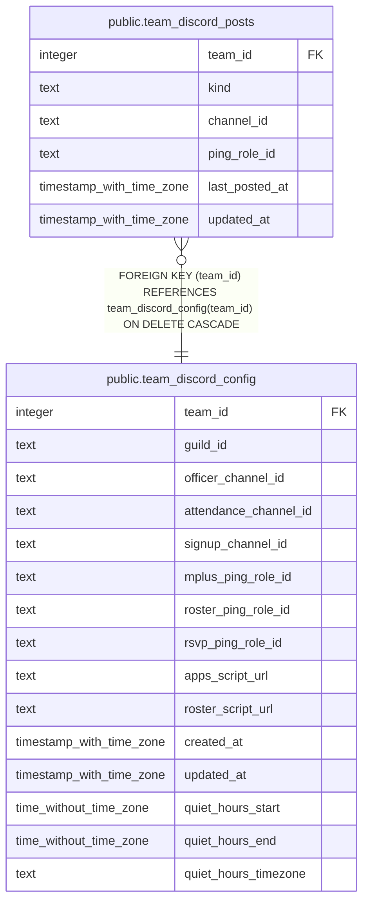

# public.team_discord_posts

## Description

One row per kind of post the bot makes for a team (#1712, #921): its channel, an optional ping role and when it last posted. No channel (or no row) means that kind is off. Changed only through set_team_discord_post(); the posting function reads it with the service key.

## Columns

| Name | Type | Default | Nullable | Children | Parents | Comment |
| ---- | ---- | ------- | -------- | -------- | ------- | ------- |
| team_id | integer |  | false |  | [public.team_discord_config](public.team_discord_config.md) |  |
| kind | text |  | false |  |  |  |
| channel_id | text |  | true |  |  |  |
| ping_role_id | text |  | true |  |  |  |
| last_posted_at | timestamp with time zone |  | true |  |  |  |
| updated_at | timestamp with time zone | now() | false |  |  |  |

## Constraints

| Name | Type | Definition |
| ---- | ---- | ---------- |
| team_discord_posts_check | CHECK | CHECK (((channel_id IS NOT NULL) OR (ping_role_id IS NULL))) |
| team_discord_posts_kind_check | CHECK | CHECK ((kind = ANY (ARRAY['officer_requests'::text, 'mplus_requests'::text, 'rsvp_changes'::text]))) |
| team_discord_posts_team_id_fkey | FOREIGN KEY | FOREIGN KEY (team_id) REFERENCES team_discord_config(team_id) ON DELETE CASCADE |
| team_discord_posts_pkey | PRIMARY KEY | PRIMARY KEY (team_id, kind) |

## Indexes

| Name | Definition |
| ---- | ---------- |
| team_discord_posts_pkey | CREATE UNIQUE INDEX team_discord_posts_pkey ON public.team_discord_posts USING btree (team_id, kind) |

## Relations

---

> Generated by [tbls](https://github.com/k1LoW/tbls)
