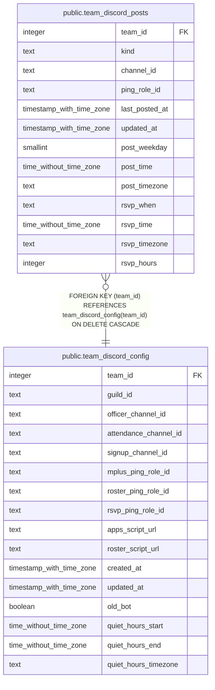

# public.team_discord_posts

## Description

One row per kind of post the bot makes for a team (#1712, #921): its channel, an optional ping role and when it last posted. No channel (or no row) means that kind is off. Changed only through set_team_discord_post(); the posting function reads it with the service key.

## Columns

| Name | Type | Default | Nullable | Children | Parents | Comment |
| ---- | ---- | ------- | -------- | -------- | ------- | ------- |
| team_id | integer |  | false |  | [public.team_discord_config](public.team_discord_config.md) |  |
| kind | text |  | false |  |  |  |
| channel_id | text |  | true |  |  |  |
| ping_role_id | text |  | true |  |  |  |
| last_posted_at | timestamp with time zone |  | true |  |  |  |
| updated_at | timestamp with time zone | now() | false |  |  |  |
| post_weekday | smallint |  | true |  |  | For the weekly lineup only (#1709): the day it posts, 0 is Sunday, in post_timezone. |
| post_time | time without time zone |  | true |  |  | For the weekly lineup only (#1709): the time it posts, in post_timezone. |
| post_timezone | text |  | true |  |  | For the weekly lineup only (#1709): the time zone its day and time are in. |
| rsvp_when | text |  | true |  |  | For RSVP changes only (#1710): daily or before_raid for a batched post, empty for one post per change. |
| rsvp_time | time without time zone |  | true |  |  | For rsvp_when = daily: the time of day the post goes out, in rsvp_timezone. |
| rsvp_timezone | text |  | true |  |  | For rsvp_when = daily: the time zone rsvp_time is in. |
| rsvp_hours | integer |  | true |  |  | For rsvp_when = before_raid: how many hours before each raid night the post goes out. |

## Constraints

| Name | Type | Definition |
| ---- | ---- | ---------- |
| team_discord_posts_check | CHECK | CHECK (((channel_id IS NOT NULL) OR (ping_role_id IS NULL))) |
| team_discord_posts_kind_check | CHECK | CHECK ((kind = ANY (ARRAY['officer_requests'::text, 'mplus_requests'::text, 'rsvp_changes'::text, 'weekly_lineup'::text]))) |
| team_discord_posts_post_weekday_check | CHECK | CHECK (((post_weekday >= 0) AND (post_weekday <= 6))) |
| team_discord_posts_rsvp_hours_check | CHECK | CHECK (((rsvp_hours >= 1) AND (rsvp_hours <= 168))) |
| team_discord_posts_rsvp_timing_check | CHECK | CHECK ( CASE     WHEN ((kind <> 'rsvp_changes'::text) OR (rsvp_when IS NULL)) THEN (num_nonnulls(rsvp_when, rsvp_time, rsvp_timezone, rsvp_hours) = 0)     WHEN (rsvp_when = 'daily'::text) THEN ((rsvp_time IS NOT NULL) AND (rsvp_timezone IS NOT NULL) AND (rsvp_hours IS NULL))     ELSE ((rsvp_hours IS NOT NULL) AND (rsvp_time IS NULL) AND (rsvp_timezone IS NULL)) END) |
| team_discord_posts_rsvp_when_check | CHECK | CHECK ((rsvp_when = ANY (ARRAY['daily'::text, 'before_raid'::text]))) |
| team_discord_posts_schedule_check | CHECK | CHECK ( CASE     WHEN ((kind = 'weekly_lineup'::text) AND (channel_id IS NOT NULL)) THEN (num_nonnulls(post_weekday, post_time, post_timezone) = 3)     ELSE (num_nonnulls(post_weekday, post_time, post_timezone) = 0) END) |
| team_discord_posts_team_id_fkey | FOREIGN KEY | FOREIGN KEY (team_id) REFERENCES team_discord_config(team_id) ON DELETE CASCADE |
| team_discord_posts_pkey | PRIMARY KEY | PRIMARY KEY (team_id, kind) |

## Indexes

| Name | Definition |
| ---- | ---------- |
| team_discord_posts_pkey | CREATE UNIQUE INDEX team_discord_posts_pkey ON public.team_discord_posts USING btree (team_id, kind) |

## Relations

---

> Generated by [tbls](https://github.com/k1LoW/tbls)
