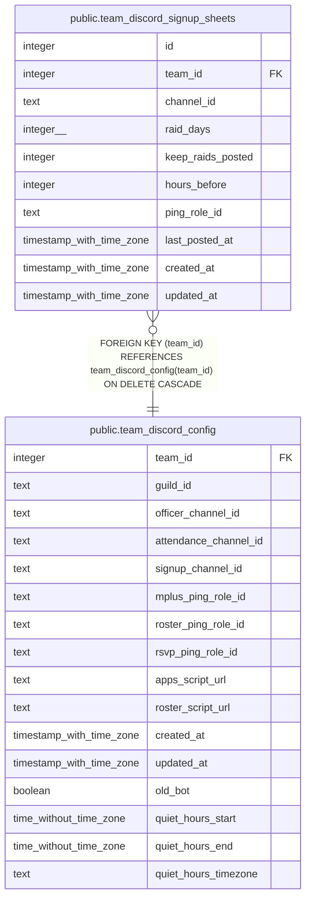

# public.team_discord_signup_sheets

## Description

A team's signup sheets in Discord (#1712): the channel, its raid days (raid_schedule's weekday, 0 = Sunday, each day on one sheet of a team at most), and either keep_raids_posted (1 to 4) or hours_before each raid. Changed only through save_team_discord_signup_sheet() and remove_team_discord_signup_sheet().

## Columns

| Name | Type | Default | Nullable | Children | Parents | Comment |
| ---- | ---- | ------- | -------- | -------- | ------- | ------- |
| id | integer |  | false |  |  |  |
| team_id | integer |  | false |  | [public.team_discord_config](public.team_discord_config.md) |  |
| channel_id | text |  | false |  |  |  |
| raid_days | integer[] |  | false |  |  |  |
| keep_raids_posted | integer |  | true |  |  |  |
| hours_before | integer |  | true |  |  |  |
| ping_role_id | text |  | true |  |  |  |
| last_posted_at | timestamp with time zone |  | true |  |  |  |
| created_at | timestamp with time zone | now() | false |  |  |  |
| updated_at | timestamp with time zone | now() | false |  |  |  |

## Constraints

| Name | Type | Definition |
| ---- | ---- | ---------- |
| team_discord_signup_sheets_check | CHECK | CHECK ((num_nonnulls(keep_raids_posted, hours_before) = 1)) |
| team_discord_signup_sheets_hours_before_check | CHECK | CHECK (((hours_before >= 1) AND (hours_before <= 168))) |
| team_discord_signup_sheets_keep_raids_posted_check | CHECK | CHECK (((keep_raids_posted >= 1) AND (keep_raids_posted <= 4))) |
| team_discord_signup_sheets_raid_days_check | CHECK | CHECK (((cardinality(raid_days) > 0) AND (raid_days <@ ARRAY[0, 1, 2, 3, 4, 5, 6]))) |
| team_discord_signup_sheets_team_id_fkey | FOREIGN KEY | FOREIGN KEY (team_id) REFERENCES team_discord_config(team_id) ON DELETE CASCADE |
| team_discord_signup_sheets_pkey | PRIMARY KEY | PRIMARY KEY (id) |

## Indexes

| Name | Definition |
| ---- | ---------- |
| team_discord_signup_sheets_pkey | CREATE UNIQUE INDEX team_discord_signup_sheets_pkey ON public.team_discord_signup_sheets USING btree (id) |
| team_discord_signup_sheets_team_id | CREATE INDEX team_discord_signup_sheets_team_id ON public.team_discord_signup_sheets USING btree (team_id) |

## Relations

---

> Generated by [tbls](https://github.com/k1LoW/tbls)
