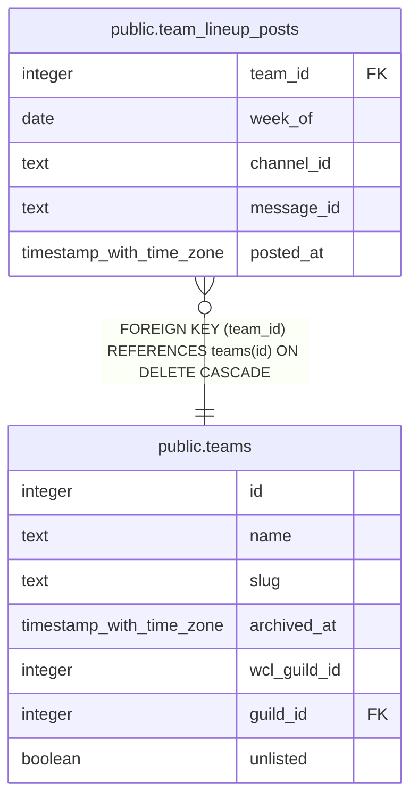

# public.team_lineup_posts

## Description

The weekly boss lineup message posted for each team and week (#1709). week_of is the date the post was due, in the team's lineup time zone. Written by discord-bot-webhook with the service role; later runs edit this message when the lineup changes.

## Columns

| Name | Type | Default | Nullable | Children | Parents | Comment |
| ---- | ---- | ------- | -------- | -------- | ------- | ------- |
| team_id | integer |  | false |  | [public.teams](public.teams.md) |  |
| week_of | date |  | false |  |  |  |
| channel_id | text |  | false |  |  |  |
| message_id | text |  | false |  |  |  |
| posted_at | timestamp with time zone | now() | false |  |  |  |

## Constraints

| Name | Type | Definition |
| ---- | ---- | ---------- |
| team_lineup_posts_team_id_fkey | FOREIGN KEY | FOREIGN KEY (team_id) REFERENCES teams(id) ON DELETE CASCADE |
| team_lineup_posts_pkey | PRIMARY KEY | PRIMARY KEY (team_id, week_of) |

## Indexes

| Name | Definition |
| ---- | ---------- |
| team_lineup_posts_pkey | CREATE UNIQUE INDEX team_lineup_posts_pkey ON public.team_lineup_posts USING btree (team_id, week_of) |

## Relations

---

> Generated by [tbls](https://github.com/k1LoW/tbls)
