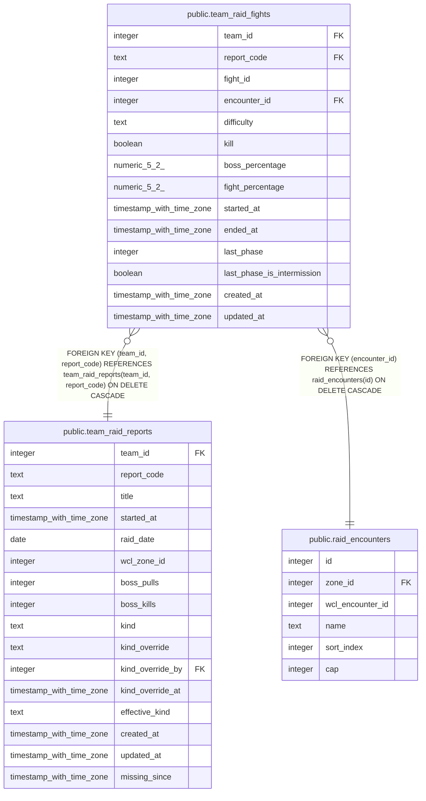

# public.team_raid_fights

## Description

Every Heroic and Mythic boss pull the progression sync reads for a team (#1470), alt runs included, one row per team, report and fight. Read by the team (its raiders, view_reports and attendance permissions) and site admins; the public reads the team's own raids' pulls through team_raid_pulls() (#1496). Written only by wcl-progression-sync.

## Columns

| Name | Type | Default | Nullable | Children | Parents | Comment |
| ---- | ---- | ------- | -------- | -------- | ------- | ------- |
| team_id | integer |  | false |  | [public.team_raid_reports](public.team_raid_reports.md) |  |
| report_code | text |  | false |  | [public.team_raid_reports](public.team_raid_reports.md) |  |
| fight_id | integer |  | false |  |  |  |
| encounter_id | integer |  | false |  | [public.raid_encounters](public.raid_encounters.md) |  |
| difficulty | text |  | false |  |  |  |
| kill | boolean |  | false |  |  | Whether the pull killed the boss. |
| boss_percentage | numeric(5,2) |  | true |  |  | The boss's health left when the pull ended, in percent (Warcraft Logs' bossPercentage); 0 on a kill. |
| fight_percentage | numeric(5,2) |  | true |  |  | The fight's own completion left, in percent (Warcraft Logs' fightPercentage), which differs from boss_percentage on a fight with several bosses or a boss that heals. |
| started_at | timestamp with time zone |  | false |  |  | When the pull started: the report's start plus the fight's offset. |
| ended_at | timestamp with time zone |  | false |  |  | When the pull ended: the report's start plus the fight's end offset. |
| last_phase | integer |  | true |  |  | The phase the pull ended in (Warcraft Logs' lastPhase); null when it has none. |
| last_phase_is_intermission | boolean |  | true |  |  | Whether last_phase is an intermission. |
| created_at | timestamp with time zone | now() | false |  |  |  |
| updated_at | timestamp with time zone | now() | false |  |  |  |

## Constraints

| Name | Type | Definition |
| ---- | ---- | ---------- |
| team_raid_fights_difficulty_check | CHECK | CHECK ((difficulty = ANY (ARRAY['heroic'::text, 'mythic'::text]))) |
| team_raid_fights_encounter_id_fkey | FOREIGN KEY | FOREIGN KEY (encounter_id) REFERENCES raid_encounters(id) ON DELETE CASCADE |
| team_raid_fights_team_id_report_code_fkey | FOREIGN KEY | FOREIGN KEY (team_id, report_code) REFERENCES team_raid_reports(team_id, report_code) ON DELETE CASCADE |
| team_raid_fights_pkey | PRIMARY KEY | PRIMARY KEY (team_id, report_code, fight_id) |

## Indexes

| Name | Definition |
| ---- | ---------- |
| team_raid_fights_pkey | CREATE UNIQUE INDEX team_raid_fights_pkey ON public.team_raid_fights USING btree (team_id, report_code, fight_id) |
| team_raid_fights_team_encounter_idx | CREATE INDEX team_raid_fights_team_encounter_idx ON public.team_raid_fights USING btree (team_id, encounter_id, difficulty) |

## Triggers

| Name | Definition |
| ---- | ---------- |
| trg_team_raid_fights_updated_at | CREATE TRIGGER trg_team_raid_fights_updated_at BEFORE UPDATE ON public.team_raid_fights FOR EACH ROW EXECUTE FUNCTION set_updated_at() |

## Relations

---

> Generated by [tbls](https://github.com/k1LoW/tbls)
