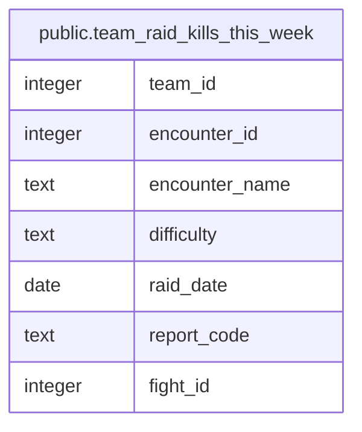

# public.team_raid_kills_this_week

## Description

Each boss a team has killed in its main reports (team_raid_reports.effective_kind, #1471) since this week's Tuesday reset, once per difficulty, with its first kill of the week (#1246).

<details>
<summary><strong>Table Definition</strong></summary>

```sql
CREATE VIEW team_raid_kills_this_week AS (
 SELECT DISTINCT ON (k.team_id, k.encounter_id, k.difficulty) k.team_id,
    k.encounter_id,
    e.name AS encounter_name,
    k.difficulty,
    k.raid_date,
    k.report_code,
    k.fight_id
   FROM ((team_raid_kills k
     JOIN raid_encounters e ON ((e.id = k.encounter_id)))
     JOIN team_raid_reports r ON (((r.team_id = k.team_id) AND (r.report_code = k.report_code))))
  WHERE ((k.raid_date >= lockout_start_at(now())) AND (k.raid_date < (lockout_start_at(now()) + 7)) AND (r.effective_kind = 'main'::text))
  ORDER BY k.team_id, k.encounter_id, k.difficulty, k.report_started_at, k.fight_id
)
```

</details>

## Columns

| Name | Type | Default | Nullable | Children | Parents | Comment |
| ---- | ---- | ------- | -------- | -------- | ------- | ------- |
| team_id | integer |  | true |  |  |  |
| encounter_id | integer |  | true |  |  |  |
| encounter_name | text |  | true |  |  |  |
| difficulty | text |  | true |  |  |  |
| raid_date | date |  | true |  |  |  |
| report_code | text |  | true |  |  |  |
| fight_id | integer |  | true |  |  |  |

## Referenced Tables

| Name | Columns | Comment | Type |
| ---- | ------- | ------- | ---- |
| [public.team_raid_kills](public.team_raid_kills.md) | 9 | Every Heroic and Mythic boss kill in a team's Warcraft Logs reports (#1246), alt runs included, one row per fight, dated by the report's raid night. Written only by wcl-progression-sync. Its readers count main reports only (team_raid_reports.effective_kind, #1471). Each insert takes the bosses the team's main reports killed off the team's later nights that lockout (skip_killed_bosses()). | BASE TABLE |
| [public.raid_encounters](public.raid_encounters.md) | 6 |  | BASE TABLE |
| [public.team_raid_reports](public.team_raid_reports.md) | 16 | Every Warcraft Logs report the progression sync reads for a team (#1469), one row per team and report, rewritten on every run and never deleted. kind is the title rule's verdict, kind_override an officer's choice, effective_kind the one that counts. Written by wcl-progression-sync, which never writes the override columns; set_report_kind() is the only writer of those (#1472). | BASE TABLE |

## Relations



---

> Generated by [tbls](https://github.com/k1LoW/tbls)
