# public.team_raider_order

## Description

The order a team lists its raiders in within a role section of Boss Lineup (#1683); position counts from 1 within the raider's role. A raider with no row lists after the placed ones, A-Z. Written only by set_lineup_raider_order().

## Columns

| Name | Type | Default | Nullable | Children | Parents | Comment |
| ---- | ---- | ------- | -------- | -------- | ------- | ------- |
| team_id | integer |  | false |  | [public.teams](public.teams.md) |  |
| player_id | integer |  | false |  | [public.players](public.players.md) |  |
| position | integer |  | false |  |  |  |
| updated_at | timestamp with time zone | now() | false |  |  |  |

## Constraints

| Name | Type | Definition |
| ---- | ---- | ---------- |
| team_raider_order_position_check | CHECK | CHECK (("position" > 0)) |
| team_raider_order_player_id_fkey | FOREIGN KEY | FOREIGN KEY (player_id) REFERENCES players(id) ON DELETE CASCADE |
| team_raider_order_team_id_fkey | FOREIGN KEY | FOREIGN KEY (team_id) REFERENCES teams(id) ON DELETE CASCADE |
| team_raider_order_pkey | PRIMARY KEY | PRIMARY KEY (team_id, player_id) |

## Indexes

| Name | Definition |
| ---- | ---------- |
| team_raider_order_pkey | CREATE UNIQUE INDEX team_raider_order_pkey ON public.team_raider_order USING btree (team_id, player_id) |
| team_raider_order_player_id_idx | CREATE INDEX team_raider_order_player_id_idx ON public.team_raider_order USING btree (player_id) |

## Relations

```mermaid
erDiagram

"public.team_raider_order" }o--|| "public.teams" : "FOREIGN KEY (team_id) REFERENCES teams(id) ON DELETE CASCADE"
"public.team_raider_order" }o--|| "public.players" : "FOREIGN KEY (player_id) REFERENCES players(id) ON DELETE CASCADE"

"public.team_raider_order" {
  integer team_id FK
  integer player_id FK
  integer position
  timestamp_with_time_zone updated_at
}
"public.teams" {
  integer id
  text name
  text slug
  timestamp_with_time_zone archived_at
  integer wcl_guild_id
  integer guild_id FK
  boolean unlisted
}
"public.players" {
  integer id
  integer team_id FK
  text name_realm
  integer class_spec_id FK
  boolean is_trial
  boolean is_bench
  text nickname
  text bis_link
  date join_date
  boolean m_plus_excluded
  text m_plus_note
  integer team_member_id FK
  timestamp_with_time_zone archived_at
  timestamp_with_time_zone updated_at
  boolean bis_allowed
  boolean is_backup_tank
  boolean is_backup_healer
  boolean wishlist_allowed
  integer tier_pieces_equipped
  timestamp_with_time_zone tier_pieces_synced_at
  integer bonus_roll_encounter_id FK
  timestamp_with_time_zone bis_link_updated_at
  text url_code
  text name_realm_key
}
```

---

> Generated by [tbls](https://github.com/k1LoW/tbls)
