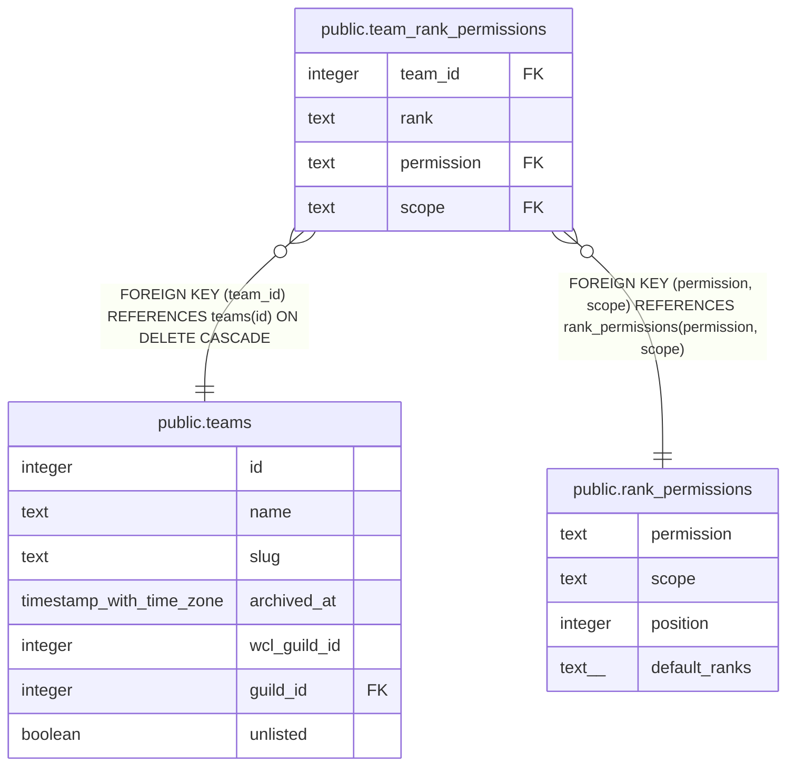

# public.team_rank_permissions

## Description

Each team's grid: a row means that team rank has that permission there (#1645). Filled from rank_permissions.default_ranks when the team is made; the Team Owner changes it later.

## Columns

| Name | Type | Default | Nullable | Children | Parents | Comment |
| ---- | ---- | ------- | -------- | -------- | ------- | ------- |
| team_id | integer |  | false |  | [public.teams](public.teams.md) |  |
| rank | text |  | false |  |  |  |
| permission | text |  | false |  | [public.rank_permissions](public.rank_permissions.md) |  |
| scope | text | 'team'::text | false |  | [public.rank_permissions](public.rank_permissions.md) |  |

## Constraints

| Name | Type | Definition |
| ---- | ---- | ---------- |
| team_rank_permissions_rank_check | CHECK | CHECK ((rank = ANY (ARRAY['raider'::text, 'assistant'::text, 'officer'::text]))) |
| team_rank_permissions_scope_check | CHECK | CHECK ((scope = 'team'::text)) |
| team_rank_permissions_team_id_fkey | FOREIGN KEY | FOREIGN KEY (team_id) REFERENCES teams(id) ON DELETE CASCADE |
| team_rank_permissions_permission_scope_fkey | FOREIGN KEY | FOREIGN KEY (permission, scope) REFERENCES rank_permissions(permission, scope) |
| team_rank_permissions_pkey | PRIMARY KEY | PRIMARY KEY (team_id, rank, permission) |

## Indexes

| Name | Definition |
| ---- | ---------- |
| team_rank_permissions_pkey | CREATE UNIQUE INDEX team_rank_permissions_pkey ON public.team_rank_permissions USING btree (team_id, rank, permission) |

## Relations

---

> Generated by [tbls](https://github.com/k1LoW/tbls)
