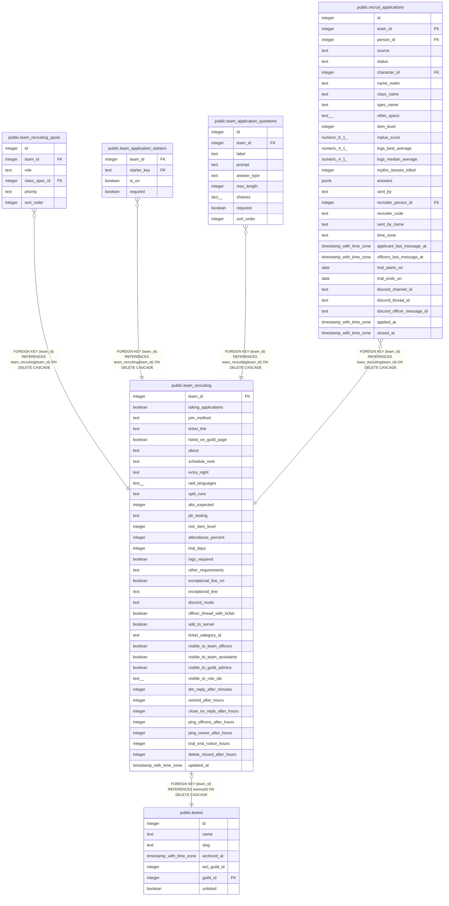

# public.team_recruiting

## Description

A team's recruiting settings, one row per team, made with the team (#1535): whether it takes applications and how people join, the apply page's text, what it asks of applicants, and what the bot does in Discord when someone applies. Read and changed by the team's officers through team_recruiting_settings() and save_team_recruiting(); the apply pages read it through team_recruiting_page(); the bot reads it with the service key.

## Columns

| Name | Type | Default | Nullable | Children | Parents | Comment |
| ---- | ---- | ------- | -------- | -------- | ------- | ------- |
| team_id | integer |  | false | [public.team_recruiting_spots](public.team_recruiting_spots.md) [public.team_application_starters](public.team_application_starters.md) [public.team_application_questions](public.team_application_questions.md) [public.recruit_applications](public.recruit_applications.md) | [public.teams](public.teams.md) |  |
| taking_applications | boolean | false | false |  |  | Off keeps everything else for next time; the apply page then says Not recruiting and still shows how the team raids. Open applications and trials carry on (#1535). |
| join_method | text | 'application'::text | false |  |  | application: the Raid Hub form. discord_ticket: no form; the apply page links to ticket_link, which must be set while taking applications. |
| ticket_link | text |  | true |  |  |  |
| listed_on_guild_page | boolean | true | false |  |  | Off lets a team recruit quietly: its own apply link still works, it just is not listed with the guild's other teams. |
| about | text |  | true |  |  | About the team, light Markdown, up to 2,000 characters. |
| schedule_note | text |  | true |  |  |  |
| extra_night | text | 'none'::text | false |  |  |  |
| raid_languages | text[] | '{}'::text[] | false |  |  | The team's raid languages in order, the first being the main one. Up to 5, each up to 30 characters. |
| split_runs | text | 'none'::text | false |  |  |  |
| alts_expected | integer |  | true |  |  | How many alts a raider is expected to keep; null hides the line. |
| ptr_testing | text | 'none'::text | false |  |  |  |
| min_item_level | integer |  | true |  |  |  |
| attendance_percent | integer |  | true |  |  |  |
| trial_days | integer | 14 | false |  |  |  |
| logs_required | boolean | false | false |  |  |  |
| other_requirements | text |  | true |  |  |  |
| exceptional_line_on | boolean | false | false |  |  | Shows exceptional_line on the apply page in addition to the open spots, never instead of them. |
| exceptional_line | text | 'Exceptional players of any class or spec are welcome to apply.'::text | false |  |  |  |
| discord_mode | text | 'none'::text | false |  |  | What the bot makes when someone applies: ticket (a private channel with the applicant and the officers), officer_thread (officers only), officer_post (one message in the officer channel) or none. ticket needs add_to_server. |
| officer_thread_with_ticket | boolean | false | false |  |  | With a ticket, also open an officer-only thread about the applicant. |
| add_to_server | boolean | false | false |  |  | Add the applicant to the team's Discord server when they apply (#1540). |
| ticket_category_id | text |  | true |  |  | The Discord category the bot makes tickets in. |
| visible_to_team_officers | boolean | true | false |  |  |  |
| visible_to_team_assistants | boolean | false | false |  |  | Assistants see tickets and officer threads (the Assistant rank is #1517's). |
| visible_to_guild_admins | boolean | false | false |  |  | The guild's Owner and Admins see tickets and officer threads. |
| visible_to_role_ids | text[] | '{}'::text[] | false |  |  | Extra Discord roles that see tickets and officer threads, such as a recruiter role. Up to 25, picked from the server (#994). |
| dm_reply_after_minutes | integer | 120 | true |  |  | DM the applicant this long after an officer's unanswered message in their ticket. Null for never. The timings are the bot's (#1543). |
| remind_after_hours | integer | 48 | true |  |  |  |
| close_no_reply_after_hours | integer | 120 | true |  |  |  |
| ping_officers_after_hours | integer | 24 | true |  |  |  |
| ping_owner_after_hours | integer | 72 | true |  |  |  |
| trial_end_notice_hours | integer | 48 | true |  |  |  |
| delete_closed_after_hours | integer | 24 | true |  |  |  |
| updated_at | timestamp with time zone | now() | false |  |  |  |

## Constraints

| Name | Type | Definition |
| ---- | ---- | ---------- |
| team_recruiting_about | CHECK | CHECK ((char_length(about) <= 2000)) |
| team_recruiting_alts_expected | CHECK | CHECK (((alts_expected >= 0) AND (alts_expected <= 10))) |
| team_recruiting_attendance_percent | CHECK | CHECK (((attendance_percent >= 1) AND (attendance_percent <= 100))) |
| team_recruiting_close_no_reply_after_hours | CHECK | CHECK (((close_no_reply_after_hours >= 1) AND (close_no_reply_after_hours <= 720))) |
| team_recruiting_delete_closed_after_hours | CHECK | CHECK (((delete_closed_after_hours >= 1) AND (delete_closed_after_hours <= 720))) |
| team_recruiting_discord_mode | CHECK | CHECK ((discord_mode = ANY (ARRAY['ticket'::text, 'officer_thread'::text, 'officer_post'::text, 'none'::text]))) |
| team_recruiting_dm_reply_after_minutes | CHECK | CHECK (((dm_reply_after_minutes >= 1) AND (dm_reply_after_minutes <= 10080))) |
| team_recruiting_exceptional_line | CHECK | CHECK (((char_length(exceptional_line) <= 200) AND (exceptional_line ~ '\S'::text) AND (exceptional_line !~ '[\r\n]'::text))) |
| team_recruiting_extra_night | CHECK | CHECK ((extra_night = ANY (ARRAY['none'::text, 'first_two_weeks'::text, 'sometimes'::text]))) |
| team_recruiting_join_method | CHECK | CHECK ((join_method = ANY (ARRAY['application'::text, 'discord_ticket'::text]))) |
| team_recruiting_min_item_level | CHECK | CHECK (((min_item_level >= 1) AND (min_item_level <= 1000))) |
| team_recruiting_other_requirements | CHECK | CHECK (((char_length(other_requirements) <= 200) AND (other_requirements !~ '[\r\n]'::text))) |
| team_recruiting_owner_after_officers | CHECK | CHECK (((ping_officers_after_hours IS NULL) OR (ping_owner_after_hours IS NULL) OR (ping_officers_after_hours < ping_owner_after_hours))) |
| team_recruiting_ping_officers_after_hours | CHECK | CHECK (((ping_officers_after_hours >= 1) AND (ping_officers_after_hours <= 720))) |
| team_recruiting_ping_owner_after_hours | CHECK | CHECK (((ping_owner_after_hours >= 1) AND (ping_owner_after_hours <= 720))) |
| team_recruiting_ptr_testing | CHECK | CHECK ((ptr_testing = ANY (ARRAY['none'::text, 'optional'::text, 'expected'::text]))) |
| team_recruiting_raid_languages | CHECK | CHECK (((cardinality(raid_languages) <= 5) AND text_items_match(raid_languages, '^(?=.*\S)[^\r\n|,;/]{1,30}$'::text))) |
| team_recruiting_remind_after_hours | CHECK | CHECK (((remind_after_hours >= 1) AND (remind_after_hours <= 720))) |
| team_recruiting_remind_before_close | CHECK | CHECK (((remind_after_hours IS NULL) OR (close_no_reply_after_hours IS NULL) OR (remind_after_hours < close_no_reply_after_hours))) |
| team_recruiting_schedule_note | CHECK | CHECK (((char_length(schedule_note) <= 100) AND (schedule_note !~ '[\r\n]'::text))) |
| team_recruiting_split_runs | CHECK | CHECK ((split_runs = ANY (ARRAY['none'::text, 'early_season'::text, 'weekly'::text]))) |
| team_recruiting_thread_with_ticket | CHECK | CHECK (((NOT officer_thread_with_ticket) OR (discord_mode = 'ticket'::text))) |
| team_recruiting_ticket_adds_to_server | CHECK | CHECK (((discord_mode <> 'ticket'::text) OR add_to_server)) |
| team_recruiting_ticket_category_id | CHECK | CHECK ((ticket_category_id ~ '^[0-9]{17,20}$'::text)) |
| team_recruiting_ticket_link | CHECK | CHECK (((ticket_link ~ '^https://[^\s]+$'::text) AND (char_length(ticket_link) <= 500))) |
| team_recruiting_ticket_needs_link | CHECK | CHECK (((NOT taking_applications) OR (join_method <> 'discord_ticket'::text) OR (ticket_link IS NOT NULL))) |
| team_recruiting_trial_days | CHECK | CHECK (((trial_days >= 1) AND (trial_days <= 90))) |
| team_recruiting_trial_end_notice_hours | CHECK | CHECK (((trial_end_notice_hours >= 1) AND (trial_end_notice_hours <= 720))) |
| team_recruiting_visible_to_role_ids | CHECK | CHECK (((cardinality(visible_to_role_ids) <= 25) AND text_items_match(visible_to_role_ids, '^[0-9]{17,20}$'::text))) |
| team_recruiting_team_id_fkey | FOREIGN KEY | FOREIGN KEY (team_id) REFERENCES teams(id) ON DELETE CASCADE |
| team_recruiting_pkey | PRIMARY KEY | PRIMARY KEY (team_id) |

## Indexes

| Name | Definition |
| ---- | ---------- |
| team_recruiting_pkey | CREATE UNIQUE INDEX team_recruiting_pkey ON public.team_recruiting USING btree (team_id) |

## Relations

---

> Generated by [tbls](https://github.com/k1LoW/tbls)
