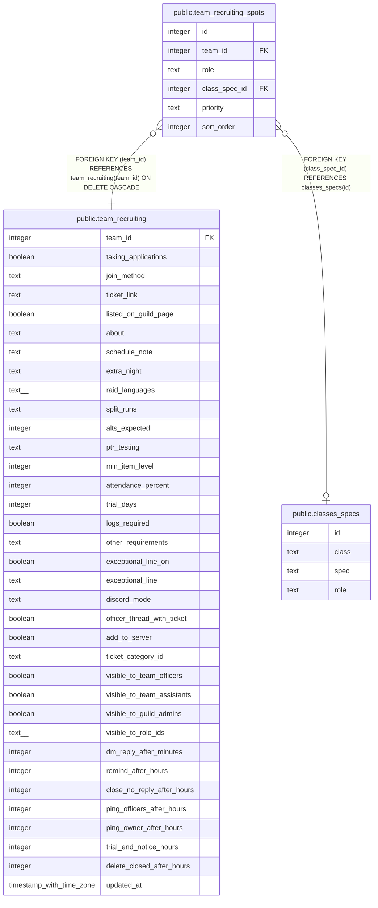

# public.team_recruiting_spots

## Description

A team's open spots (#1535), one row each, in sort_order. A spec, or no spec for Any tank, Any healer, Any melee or Any ranged. role matches the spec's. Replaced as a list through set_team_recruiting_spots().

## Columns

| Name | Type | Default | Nullable | Children | Parents | Comment |
| ---- | ---- | ------- | -------- | -------- | ------- | ------- |
| id | integer |  | false |  |  |  |
| team_id | integer |  | false |  | [public.team_recruiting](public.team_recruiting.md) |  |
| role | text |  | false |  |  |  |
| class_spec_id | integer |  | true |  | [public.classes_specs](public.classes_specs.md) |  |
| priority | text |  | false |  |  |  |
| sort_order | integer |  | false |  |  |  |

## Constraints

| Name | Type | Definition |
| ---- | ---- | ---------- |
| team_recruiting_spots_priority_check | CHECK | CHECK ((priority = ANY (ARRAY['high'::text, 'medium'::text, 'low'::text]))) |
| team_recruiting_spots_role_check | CHECK | CHECK ((role = ANY (ARRAY['tank'::text, 'healer'::text, 'melee'::text, 'ranged'::text]))) |
| team_recruiting_spots_class_spec_id_fkey | FOREIGN KEY | FOREIGN KEY (class_spec_id) REFERENCES classes_specs(id) |
| team_recruiting_spots_team_id_fkey | FOREIGN KEY | FOREIGN KEY (team_id) REFERENCES team_recruiting(team_id) ON DELETE CASCADE |
| team_recruiting_spots_pkey | PRIMARY KEY | PRIMARY KEY (id) |

## Indexes

| Name | Definition |
| ---- | ---------- |
| team_recruiting_spots_pkey | CREATE UNIQUE INDEX team_recruiting_spots_pkey ON public.team_recruiting_spots USING btree (id) |
| team_recruiting_spots_spec | CREATE UNIQUE INDEX team_recruiting_spots_spec ON public.team_recruiting_spots USING btree (team_id, class_spec_id) WHERE (class_spec_id IS NOT NULL) |
| team_recruiting_spots_any | CREATE UNIQUE INDEX team_recruiting_spots_any ON public.team_recruiting_spots USING btree (team_id, role) WHERE (class_spec_id IS NULL) |

## Relations

---

> Generated by [tbls](https://github.com/k1LoW/tbls)
